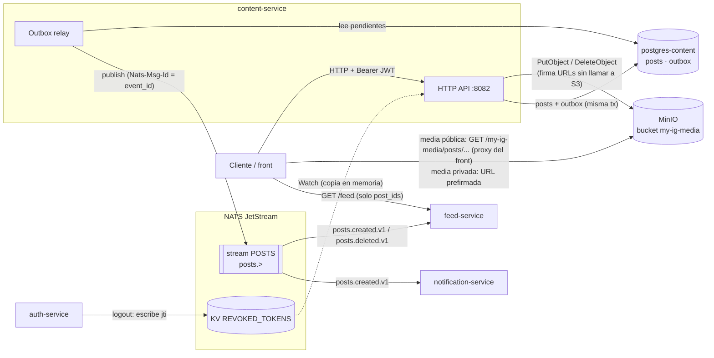
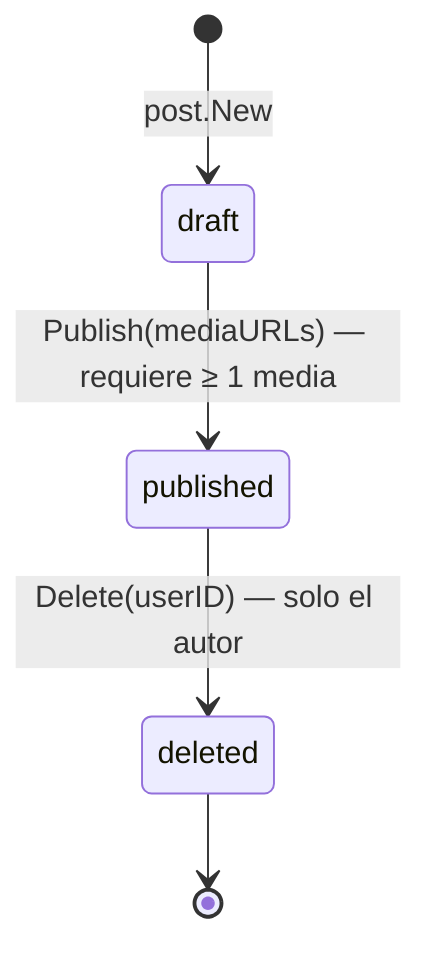
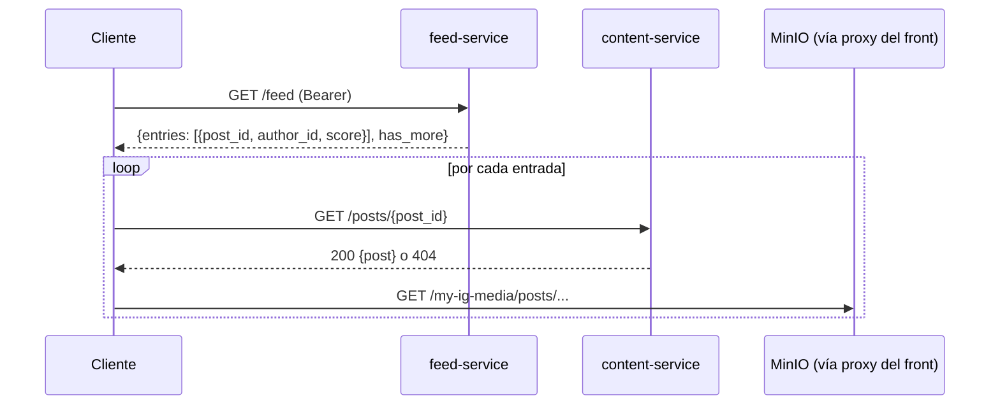

# content-service

Bounded context de **contenido**: creación, lectura, listado y borrado de posts, y almacenamiento
de su media (imágenes y videos) en MinIO. Es la fuente de verdad de los posts; feed-service
solo guarda referencias (`post_id`) y el cliente pide el contenido a este servicio.

MinIO es el object storage del sistema (reemplazó a AWS S3). Se habla con él por su API
compatible con S3, así que en el código y en este documento "S3" se refiere a esa API: el
cliente es el AWS SDK v2, las variables se llaman `S3_*` y el adaptador vive en `storage/s3/`.

| | |
|---|---|
| Puerto | `8082` |
| Base de datos | `postgres-content` → `ig_content` |
| Object storage | MinIO, bucket `my-ig-media` |
| Código | [`services/content-service/`](../../services/content-service/) |
| Migraciones | [`deploy/migrations/content-service/`](../../deploy/migrations/content-service/) |
| Eventos que publica | `posts.created.v1`, `posts.deleted.v1` |
| Eventos que consume | — |

---

## Intercomunicación



- **Ningún servicio llama a content-service por HTTP**, y content-service no llama a ninguno.
  Todo lo que sale hacia otros servicios va por eventos.
- **auth-service** no se consulta nunca: el JWT se valida localmente con `JWT_SECRET` y la lista
  de tokens revocados (ver [AUTH.md](AUTH.md#revocación-logout)).
- **feed-service** devuelve solo IDs; el cliente hidrata cada entrada con `GET /posts/{id}`
  (ver [secuencia](#lectura-desde-el-feed)).
- La **media** no pasa por content-service al leerla. La de posts públicos se baja de MinIO a
  través del proxy del front (`S3_BASE_URL=/my-ig-media` es una ruta relativa). La de posts no
  públicos solo se puede leer con una URL prefirmada que content-service le da al autor (ver
  [Object storage](#object-storage)).

---

## Arquitectura

Hexagonal: el dominio y la aplicación no importan nada de infraestructura (salvo
`chimiddleware.GetReqID` en los casos de uso, para el `trace_id`).

```
services/content-service/
├── cmd/server/main.go                          # wiring: DB, NATS, S3, streams, outbox relay, HTTP
├── configs/config.go                           # config desde env vars
└── internal/
    ├── domain/
    │   ├── post/    post.go                    # agregado Post + invariantes + extracción de tags
    │   │            events.go                  # builders de Envelope (created, deleted)
    │   │            repository.go              # puerto post.Repository
    │   └── media/   media.go                   # value object Media: validación de tipo/tamaño, S3 key
    ├── application/
    │   ├── port/input/  post_usecase.go        # puerto driving: CreatePost, GetPost, ListUserPosts, DeletePost
    │   ├── port/output/ event_publisher.go     # puerto driven: EventPublisher
    │   │                media_store.go         # puerto driven: MediaStore
    │   │                tx_manager.go          # puerto driven: TxManager
    │   └── usecase/     create_post.go  get_post.go  list_user_posts.go  delete_post.go
    └── infrastructure/
        ├── http/        handler/ router/ middleware/   # adaptador HTTP (chi) + JWTMiddleware
        ├── persistence/postgres/               # PostRepository
        └── storage/s3/  s3_store.go            # adaptador MediaStore sobre MinIO (AWS SDK v2, path-style)
```

Dependencias de `shared/`:
- `shared/events`: `Envelope`, tópicos y payloads (`PostCreatedPayload`, `PostDeletedPayload`).
- `shared/outbox`: `TxManager`, `Publisher` (escribe en la tabla `outbox`) y `Relay` (publica a JetStream).
- `shared/revocation`: `Denylist`, la lista de access tokens revocados por logout.

---

## Modelo de dominio

### `Post` (agregado raíz)

| Campo | Regla |
|---|---|
| `ID` | UUID generado en `post.New`. |
| `AuthorID` | El `sub` del JWT. Obligatorio. No hay FK: los usuarios viven en otra base. |
| `Caption` | Se recortan espacios. Máximo 2200 caracteres (runas). Puede ser vacío. |
| `Status` | `draft` → `published` → `deleted` (ver abajo). |
| `Visibility` | `public` (default), `followers_only` o `private`. Cualquier otro valor es `ErrInvalidVisibility`. |
| `MediaURLs` | URLs devueltas por `MediaStore.Upload`, en el orden en que se subieron. Al menos una para publicar. |
| `Tags` | Hashtags del caption: en minúsculas, sin `#` ni puntuación final (`.,!?;:`), sin duplicados. `"#Go #go, #test"` → `["go", "test"]`. |
| `CreatedAt` / `UpdatedAt` / `DeletedAt` | UTC. `DeletedAt` solo se setea al borrar. |

Errores de dominio:

| Error | Se traduce a |
|---|---|
| `ErrInvalidCaption`, `ErrInvalidVisibility` | `400` |
| `ErrPostNotFound` | `404` |
| `ErrNotAuthor` | `403` |
| `ErrAlreadyDeleted` | `410` |

### Ciclo de vida



El estado `draft` existe solo en memoria durante `CreatePost`: el post se persiste ya publicado.
El borrado es **soft delete**: la fila queda con `status = 'deleted'` y `deleted_at`.

### Visibilidad

`Post.IsVisible()` es `status = published AND visibility = public`. Hoy no se consulta el grafo
social, así que para quien no es el autor **`followers_only` se comporta igual que `private`**.

| Quién pide | `GET /posts/{id}` | `GET /users/{id}/posts` |
|---|---|---|
| El autor (con token) | Cualquier post suyo no borrado | Todos sus posts no borrados, de cualquier visibilidad |
| Otro usuario / anónimo | Solo si es visible | Solo los visibles |

### `Media` (value object)

| Regla | Valor |
|---|---|
| MIME types aceptados | `image/jpeg`, `image/png`, `image/webp` → `image`; `video/mp4`, `video/webm` → `video` |
| Tamaño máximo por archivo | Imágenes 8 MB, videos 50 MB |
| Archivos por post | 1 a 10 (`post.MaxMediaPerPost`) |
| S3 key | `posts/{post_id}/{media_id}{ext}` si el post es `public`, `private/posts/{post_id}/{media_id}{ext}` si no. La extensión sale del tipo detectado (`.jpg`, `.png`, `.webp`, `.mp4`, `.webm`) |

El MIME type se **detecta por contenido**: `CreatePost` lee los primeros 512 bytes de cada
archivo y usa `http.DetectContentType` (magic numbers). El `Content-Type` y el nombre que manda
el cliente se ignoran: un `.txt` declarado como `image/png` se rechaza, y un PNG declarado como
`image/jpeg` se guarda como PNG. El tipo detectado es también el `Content-Type` del objeto en S3.

Los errores de validación son `*media.FileError{Filename, Err}`, con `Err` en `ErrUnsupportedType`
o `ErrFileTooLarge`, así la respuesta dice qué archivo se rechazó. `Media` se construye para
validar y armar la key; no se persiste.

---

## API HTTP

Todas las respuestas de error tienen la forma `{"error": "<mensaje>"}`.

| Método | Ruta | Auth | Éxito |
|---|---|---|---|
| `POST` | `/posts` | Bearer (access) | `201` post |
| `GET` | `/posts/{id}` | Bearer opcional | `200` post |
| `GET` | `/users/{id}/posts` | Bearer (access) | `200` lista de posts |
| `DELETE` | `/posts/{id}` | Bearer (access) | `204` |
| `GET` | `/health`, `/ready` | — | `200` (sin body) |

Los endpoints con Bearer responden `401` con `missing authorization header`, `invalid token`,
`token expired` o `token revoked` (mismo `JWTMiddleware` que el resto de los servicios).

La especificación completa está en [`api/openapi/specs.yaml`](../../api/openapi/specs.yaml) y hay
ejemplos en la colección de Postman ([`api/postman/`](../../api/postman/)).

### Representación de un post

```json
{
  "id": "d49bc9a7-2d56-4d80-b230-7badfda0694a",
  "author_id": "7ff6a4b8-795a-47bf-a680-06b71c49b7de",
  "caption": "hola #Go #go, #test",
  "status": "published",
  "visibility": "public",
  "media_urls": ["/my-ig-media/posts/d49bc9a7-.../8bdb9cec-....png"],
  "tags": ["go", "test"],
  "created_at": "2026-10-23T14:25:11Z"
}
```

En un post `public`, `media_urls` es `S3_BASE_URL + "/" + key`; con la config del compose es una
ruta relativa que el front resuelve contra su propio origen. En un post `private` o
`followers_only` (que solo recibe el autor) cada URL es **prefirmada y absoluta**, válida por 1 h:

```
http://localhost:9000/my-ig-media/private/posts/<post_id>/<media_id>.png?X-Amz-Algorithm=...&X-Amz-Expires=3600&X-Amz-Signature=...
```

La DB guarda siempre la URL sin firmar; la firma se genera en cada lectura.

### `POST /posts`

`multipart/form-data`:

| Campo | Tipo | |
|---|---|---|
| `media` | archivo, repetible | De 1 a 10. Imágenes hasta 8 MB, videos hasta 50 MB. |
| `caption` | texto | Opcional. |
| `visibility` | texto | Opcional, default `public`. |

```bash
curl -H "Authorization: Bearer $TOKEN" \
     -F caption='atardecer #playa' -F visibility=public \
     -F media=@foto1.jpg -F media=@foto2.png \
     http://localhost:8082/posts
```

| Status | Cuándo |
|---|---|
| `201` | Post creado y publicado. Se encola `posts.created.v1` en la misma transacción. |
| `400` | Multipart inválido, ningún archivo `media` o más de 10, caption de más de 2200 caracteres, `visibility` fuera de `public`/`followers_only`/`private`, o un archivo de tipo no soportado (ej. `"nota.txt: unsupported media type (...)"`). |
| `401` | Token ausente, inválido, expirado o revocado. |
| `413` | El body supera 100 MB (`"request exceeds maximum size of 100MB"`), o un archivo supera su límite (ej. `"foto.png: file too large (max 8MB for images)"`). |
| `500` | Error inesperado (Postgres, S3). |

Todas las validaciones corren **antes** de subir nada a S3: un request rechazado no deja objetos.
El tope de 100 MB lo aplica `http.MaxBytesReader` mientras se lee el body, así que un request más
grande se corta sin leerlo entero. Del multipart, hasta 10 MB quedan en memoria y el resto va a
archivos temporales, que se borran al terminar el request.

### `GET /posts/{id}`

Público, con auth opcional (`OptionalJWTMiddleware`):

- **Sin header `Authorization`:** devuelve el post solo si es visible (`published` + `public`).
- **Con token del autor:** devuelve también sus posts `followers_only` y `private`.
- **Con header pero token inválido, expirado o revocado:** `401`, igual que en las rutas
  protegidas. No se degrada a anónimo: el cliente se entera de que su token no sirve.

Un post borrado da `404` para todos, incluido el autor.

| Status | Cuándo |
|---|---|
| `200` | Post visible, o post propio no borrado. |
| `400` | `id` no es un UUID. |
| `401` | Se mandó `Authorization` con un token que no es válido. |
| `404` | No existe, está borrado, o no es público y quien pide no es el autor. |

### `GET /users/{id}/posts?limit=20&offset=0`

Posts no borrados del autor `{id}`, más recientes primero. Si el token es del mismo autor
incluye todas las visibilidades; si no, solo los públicos.

- `limit`: default 20, máximo 50. Un valor no numérico o `≤ 0` usa el default.
- `offset`: default 0. Paginación por offset (no por cursor).
- Un autor inexistente devuelve `200 []`.

| Status | Cuándo |
|---|---|
| `200` | Lista (posiblemente vacía). |
| `400` | `id` no es un UUID. |
| `401` | Token ausente o inválido. |
| `500` | Error inesperado. |

### `DELETE /posts/{id}`

Soft delete. Encola `posts.deleted.v1` con `reason = "user_request"` y, después del commit,
borra la media de S3 en background.

| Status | Cuándo |
|---|---|
| `204` | Post borrado. |
| `400` | `id` no es un UUID. |
| `401` | Token ausente o inválido. |
| `403` | El token no es del autor. |
| `404` | El post no existe. |
| `410` | El post ya estaba borrado. |
| `500` | Error inesperado. |

---

## Flujos

### Creación de un post

```mermaid
sequenceDiagram
    participant C as Cliente
    participant H as content-service (HTTP)
    participant S3 as MinIO
    participant DB as postgres-content
    participant R as Outbox relay
    participant JS as NATS (stream POSTS)
    participant F as feed-service
    participant N as notification-service

    C->>H: POST /posts (multipart: caption, visibility, media[])
    H->>H: JWTMiddleware (firma, exp, kind, denylist)
    H->>H: post.New → draft (caption, visibility, tags)
    loop por cada archivo
        H->>H: detectar MIME (512 bytes) + media.New (tipo, tamaño, key)
    end
    Note over H: cualquier error hasta acá → 400/413, nada subido
    loop por cada archivo
        H->>S3: PutObject posts/{post_id}/{media_id}.ext
    end
    H->>H: Publish(mediaURLs) → published
    H->>DB: BEGIN; INSERT posts; INSERT outbox (posts.created.v1); COMMIT
    H-->>C: 201 {post}

    Note over R,DB: cada 500 ms
    R->>DB: SELECT pendientes FOR UPDATE SKIP LOCKED
    R->>JS: publish posts.created.v1 (Nats-Msg-Id = event_id)
    R->>DB: UPDATE outbox SET published_at

    JS->>F: posts.created.v1
    F->>F: fan-out: author_posts + feed_entries (autor y seguidores)
    JS->>N: posts.created.v1
    N->>N: solo loguea (TODO fase 2)
```

S3 no participa de la transacción. Si algo falla **después** de subir archivos (el upload de
otro archivo o el commit), un `defer` borra en background los que ya se
habían subido. Es compensación best-effort: si el borrado falla queda un objeto huérfano y se
loguea `media delete failed`. Si el proceso muere entre el upload y el commit, también quedan
huérfanos y nada los limpia.

Los archivos se suben **en serie** y dentro del request: el tiempo de respuesta crece con la
cantidad y el tamaño de la media.

### Borrado de un post

```mermaid
sequenceDiagram
    participant C as Cliente
    participant H as content-service (HTTP)
    participant DB as postgres-content
    participant S3 as MinIO
    participant R as Outbox relay
    participant JS as NATS (stream POSTS)
    participant F as feed-service

    C->>H: DELETE /posts/{id}
    H->>DB: BEGIN
    H->>DB: SELECT post
    H->>H: p.Delete(sub) — ¿autor? ¿ya borrado?
    H->>DB: UPDATE posts SET status = 'deleted', deleted_at
    H->>DB: INSERT outbox (posts.deleted.v1); COMMIT
    H-->>C: 204
    H--)S3: DeleteObject por cada media_url (goroutine)

    R->>JS: publish posts.deleted.v1
    JS->>F: posts.deleted.v1
    F->>F: borra feed_entries y author_posts del post
```

La media se borra **solo después del commit**: si la transacción falla, el post sigue vivo y
necesita sus archivos. La fila del post conserva `media_urls` apuntando a objetos que ya no
existen.

### Lectura desde el feed



Solo los posts `public` llegan al feed de los seguidores; los `private` y `followers_only` van
únicamente al feed del autor, que los puede hidratar porque manda su token. Una entrada puede
responder `404` si el post se borró y feed-service todavía no procesó el `posts.deleted.v1`.

---

## Persistencia

### Postgres

| Tabla | Uso |
|---|---|
| `posts` | Agregado `Post`. `status` y `visibility` son enums de Postgres; `media_urls` y `tags` son `TEXT[]`. Sin FK a usuarios. |
| `media` | Metadata de cada archivo (tipo, MIME, tamaño, key). Creada por la migración `0002`, **sin uso en el código**. |
| `outbox` | Eventos pendientes de publicar. |

Índices de `posts`: `(author_id, created_at DESC)` para el listado por autor, `status`, y GIN
sobre `tags` (hoy ningún endpoint busca por tag).

El repositorio usa `outbox.Conn(ctx, pool)`: si hay una transacción en el `ctx` la usa, si no, el
pool. El filtro de visibilidad del listado va en el SQL (y no después del `LIMIT`) para que las
páginas vengan completas; tiene que coincidir con `Post.IsVisible`.

Migraciones (golang-migrate, las corre el contenedor `migrate-content` al levantar el stack):

| Versión | Contenido |
|---|---|
| `0001` | Enums `post_status`, `post_visibility`; tabla `posts` e índices |
| `0002` | `media` (FK a `posts` con `ON DELETE CASCADE`) |
| `0003` | `outbox` + índice parcial de pendientes |

### Object storage

- Bucket `my-ig-media`, creado por el contenedor `minio-setup`. La política deja leer y listar
  anónimamente **solo el prefijo `posts/`** (media de posts públicos); todo lo demás, incluido
  `private/`, es privado. Los objetos se suben sin ACL: el acceso lo decide solo la política.
- La media de posts no públicos se lee con **URLs prefirmadas** (`MediaStore.PresignedURL`, TTL
  1 h), que los casos de uso generan después de autorizar al autor (`presignPrivateMedia`). Las
  firma un segundo cliente S3 configurado con `S3_PRESIGN_ENDPOINT`: la firma incluye el host, y
  tiene que ser el que usa el navegador (`localhost:9000`), no el de la red de Docker
  (`minio:9000`). Firmar no hace ningún request a S3.
- El cliente usa path-style (`http://minio:9000/my-ig-media/<key>`), que es lo que requiere MinIO.
- `Delete` y `PresignedURL` aceptan la key o la URL pública: le quitan el prefijo
  `S3_BASE_URL + "/"`.

La visibilidad de un post no se puede cambiar después de creado (no hay endpoint de update),
así que el prefijo elegido al subir siempre coincide con la visibilidad.

---

## Eventos

Se publican con **transactional outbox** (`shared/outbox`), igual que en auth-service: el evento
se inserta en `outbox` en la misma transacción que el cambio, y el relay lo publica a JetStream
con `Nats-Msg-Id = event_id`. Si NATS está caído, la operación HTTP igual responde bien y el
evento sale cuando NATS vuelve. El `trace_id` es el request ID de chi (el header `X-Request-Id`
del cliente si viene, si no uno generado).

Al arrancar, content-service crea (si no existen) los streams `POSTS` (`posts.>`), `AUTH`
(`auth.>`) y `USERS` (`users.>`), con almacenamiento en disco y retención de 7 días.

| Tópico | Stream | Cuándo | Payload | `idempotency_key` |
|---|---|---|---|---|
| `posts.created.v1` | `POSTS` | Post creado | `post_id`, `author_id`, `media_count`, `visibility`, `tags`, `created_at` | `idemp:content:create:<post_id>` |
| `posts.deleted.v1` | `POSTS` | Post borrado | `post_id`, `author_id`, `reason`, `deleted_at` | `idemp:content:delete:<post_id>` |

Consumidores (durables de JetStream, con reintentos y DLQ de `shared/dlq`):

| Servicio | Durable | Qué hace |
|---|---|---|
| feed-service | `feed-service-post-created` | Agrega el post al feed del autor. Si es `public`, además lo guarda en `author_posts` (para el backfill de nuevos seguidores) y lo agrega al feed de cada seguidor activo. Idempotente (`ON CONFLICT DO NOTHING`). |
| feed-service | `feed-service-post-deleted` | Borra las entradas del post del feed y de `author_posts`. |
| notification-service | `notification-service-post-created` | Solo loguea. Notificar a los seguidores queda para fase 2. |

`posts.created.v1` se publica para cualquier visibilidad; el filtro lo hace feed-service con el
campo `visibility` del payload. `followers_only` se trata como `private` hasta que
content-service pueda autorizar a los seguidores (si no, les llegaría una entrada que responde
`404`).

---

## Configuración

| Variable | Requerida | Default | Descripción |
|---|---|---|---|
| `JWT_SECRET` | Sí | — | Secreto HMAC. Debe coincidir con auth-service. |
| `DB_DSN` | Sí | — | DSN de Postgres. |
| `NATS_URL` | Sí | — | URL de NATS. |
| `S3_BUCKET` | Sí | — | En el compose: `my-ig-media`. |
| `S3_REGION` | Sí | — | En el compose: `us-east-1` (MinIO la ignora). |
| `S3_BASE_URL` | Sí | — | Prefijo de las URLs públicas. En el compose: `/my-ig-media` (relativo, servido por el proxy del front). |
| `S3_ACCESS_KEY` / `S3_SECRET_KEY` | Sí | — | En el compose: `minioadmin` / `minioadmin`. |
| `S3_ENDPOINT` | No | — | URL de MinIO. En el compose: `http://minio:9000`. Hay que setearla: vacía, el SDK apunta a AWS S3. |
| `S3_PRESIGN_ENDPOINT` | No | `S3_ENDPOINT` | Endpoint con el que se firman las URLs de media privada; el que alcanza el navegador. En el compose: `http://localhost:9000`. |
| `PORT` | No | `8082` | Puerto HTTP. |
| `HTTP_READ_TIMEOUT` / `HTTP_WRITE_TIMEOUT` | No | `30s` | Un upload de hasta 100 MB por una conexión lenta puede cortarse por el read timeout. |
| `HTTP_IDLE_TIMEOUT` | No | `60s` | |
| `DB_CONNECT_TIMEOUT` / `NATS_CONNECT_TIMEOUT` | No | `5s` | |
| `LOG_LEVEL` | No | `info` | No se lee. |

Si falta alguna variable requerida, el servicio no arranca y lista todas las que faltan juntas.
Una duración con formato inválido cae al default **sin avisar**.

El pool de Postgres usa 10 conexiones máximas y 2 mínimas (fijo en código). La conexión a NATS
reintenta para siempre (`MaxReconnects(-1)`). El servicio arranca solo si conectan Postgres, NATS,
la creación de streams y la carga inicial de la lista de revocados; la conexión a S3 no se prueba
al arrancar.

---

## Operación

```bash
docker compose up -d content-service  # desde la raíz (el .env define COMPOSE_FILE)
make logs-content                     # logs JSON (slog)
```

- **Dependencias en el compose:** `postgres-content`, `nats`, `minio` (healthy), `minio-setup` y
  `migrate-content` (completados). Consola de MinIO en `http://localhost:9001`.
- **Logs:** JSON por stdout con `request_id`, `post_id` y `author_id`. Además, chi loguea cada
  request en texto plano (`middleware.Logger`).
- **Graceful shutdown:** con `SIGINT`/`SIGTERM` deja de aceptar requests (timeout de 15 s) y
  después detiene el relay. Los eventos pendientes quedan en `outbox` y se publican al reiniciar.
  Los borrados de media en background que estén en curso se pierden (quedan huérfanos).
- **Tests:** solo de dominio. [`media_test.go`](../../services/content-service/internal/domain/media/media_test.go)
  cubre tipos aceptados y rechazados, el límite de tamaño y la extensión de la key;
  [`post_test.go`](../../services/content-service/internal/domain/post/post_test.go) cubre la
  validación de `visibility`. No hay tests de los casos de uso, del handler ni de los adaptadores.

---

## Pendiente

El servicio está en etapa de desarrollo. Nada de esto es un bug: son piezas que todavía no se
conectaron y restos de código para limpiar.

- **Tabla `media`** (migración `0002`): pensada para guardar la metadata de cada archivo (tipo,
  MIME, tamaño, key) y permitir auditoría y limpieza de huérfanos. Hoy no se escribe; los posts
  guardan solo `media_urls`.
- **Índices sin consulta que los use:** el GIN sobre `tags` (búsqueda por hashtag) y el de
  `status`.
- **Tests:** hay tests de dominio; faltan los de casos de uso, handler y adaptadores
  (Postgres, MinIO).
- **Restos para limpiar:** `TraceID` en `CreatePostCommand`/`DeletePostCommand` se completa y no
  se lee (el caso de uso toma el request ID de chi); `LOG_LEVEL` no se lee; `X-User-ID` sigue
  en los headers permitidos de CORS.

---

## Limitaciones conocidas

Verificadas contra el servicio corriendo. Ordenadas por impacto.

1. **Una URL prefirmada sirve para cualquiera durante 1 h.** Es una URL de capacidad: si el
   autor la comparte, quien la reciba puede bajar la media hasta que expire. Tampoco se puede
   revocar antes; borrar el post sí borra el objeto.

2. **`followers_only` funciona como `private`.** No se consulta social-service: solo el autor
   ve esos posts, y feed-service no los reparte a los seguidores.

3. **Borrados concurrentes del mismo post.** `FindByID` no toma lock (`FOR UPDATE`) y el `UPDATE`
   no filtra por `status`, así que dos `DELETE` simultáneos pueden responder ambos `204` y
   encolar dos `posts.deleted.v1` con distinto `event_id` (el dedupe de JetStream no los
   descarta). feed-service lo tolera porque el borrado es idempotente.

4. **Media huérfana sin limpieza.** Los borrados en S3 (compensación al crear y borrado al
   eliminar) son best-effort en goroutines: si fallan o el proceso se detiene, el objeto queda y
   solo se loguea. Nada barre `posts/` ni `private/posts/` buscando objetos sin post.

5. **`GET /users/{id}/posts` exige token** aunque para otros usuarios solo devuelve posts
    públicos, que `GET /posts/{id}` sirve sin token.

6. **CORS fijo a `http://localhost:5173`.** Igual que en auth-service.
