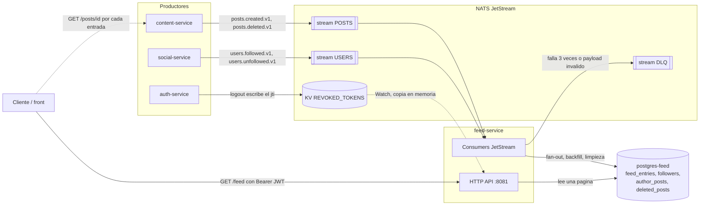
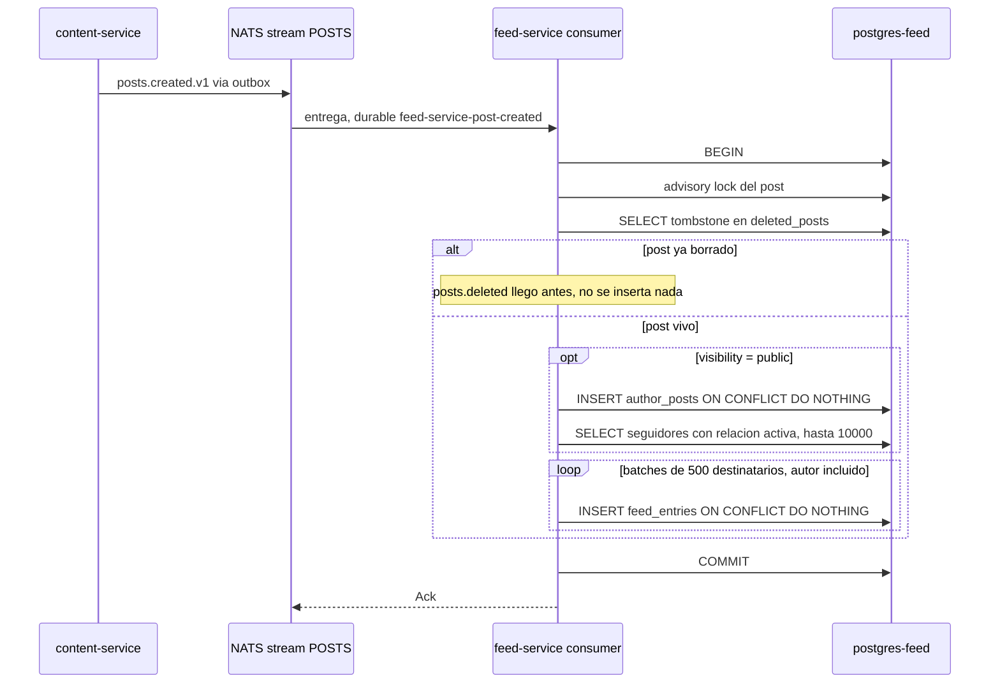
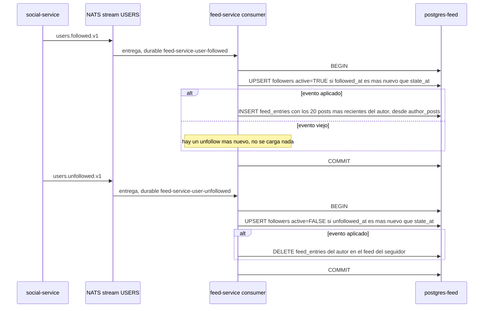
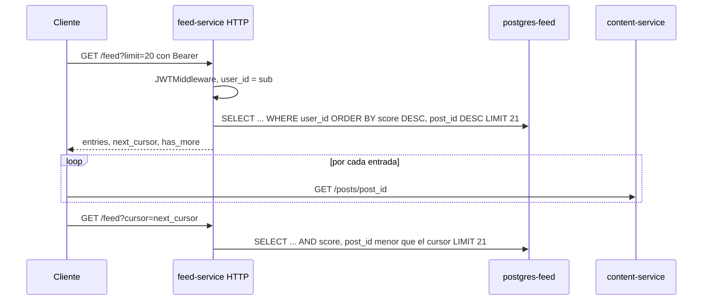

# feed-service

Bounded context de **timeline**: mantiene, para cada usuario, la lista materializada de posts
que tiene que ver (los propios y los de quienes sigue) y la sirve paginada. Es una proyección de
lectura: no crea posts ni follows, los aprende de los eventos de content-service y
social-service. Solo guarda IDs; el contenido de cada post lo pide el cliente a content-service.

| | |
|---|---|
| Puerto | `8081` |
| Base de datos | `postgres-feed` → `ig_feed` |
| Código | [`services/feed-service/`](../../services/feed-service/) |
| Migraciones | [`deploy/migrations/feed-service/`](../../deploy/migrations/feed-service/) |
| Eventos que publica | — |
| Eventos que consume | `posts.created.v1`, `posts.deleted.v1`, `users.followed.v1`, `users.unfollowed.v1` |

---

## Intercomunicación



- **feed-service no llama a ningún servicio por HTTP y nadie lo llama a él**, salvo el cliente.
  Todo lo que sabe de posts y follows llega por eventos.
- **No consulta a social-service:** mantiene su propia copia del grafo (`followers`) a partir de
  `users.followed.v1` / `users.unfollowed.v1`.
- **No consulta a content-service:** guarda solo `post_id`, `author_id` y un score. El cliente
  hidrata cada entrada con `GET /posts/{id}` (ver [CONTENT.md](CONTENT.md#lectura-desde-el-feed)).
- **auth-service** no se consulta: el JWT se valida localmente (ver
  [AUTH.md](AUTH.md#validación-en-los-otros-servicios)).

---

## Arquitectura

Hexagonal: el dominio y la aplicación no importan nada de infraestructura.

```
services/feed-service/
├── cmd/server/main.go                          # wiring: DB, NATS, streams, consumers, HTTP
├── configs/config.go                           # config desde env vars
└── internal/
    ├── domain/feed/
    │   ├── feed_entry.go                       # FeedEntry, Cursor, errores
    │   └── repository.go                       # puertos feed.Repository, feed.FollowerRepository
    ├── application/
    │   ├── port/input/  feed_usecase.go        # puerto driving: GetFeed
    │   │                fanout_usecase.go      # puerto driving: FanOut
    │   ├── port/output/ tx_manager.go          # puerto driven: TxManager
    │   └── usecase/     get_feed.go  fan_out.go
    └── infrastructure/
        ├── http/        handler/ router/ middleware/   # adaptador HTTP (chi) + JWTMiddleware
        ├── messaging/natsconsumer/consumer.go  # adaptador driving: eventos → casos de uso
        └── persistence/postgres/               # FeedRepository, FollowerRepository
```

El fan-out pasa por un caso de uso (`FanOutService`). Los otros tres eventos (borrado, follow,
unfollow) los resuelve el consumer directamente contra los repositorios, dentro de una
transacción.

Dependencias de `shared/`:
- `shared/events`: `Envelope`, tópicos y payloads que consume.
- `shared/dlq`: suscripción durable con reintentos, backoff y dead letter queue.
- `shared/outbox`: solo `TxManager` y `Conn` para las transacciones (no publica eventos).
- `shared/revocation`: `Denylist`, la lista de access tokens revocados por logout.

---

## Modelo de dominio

### `FeedEntry`

Una fila por cada post visible en el timeline de un usuario.

| Campo | Regla |
|---|---|
| `UserID` | Dueño del feed. |
| `PostID` | Post que aparece. Único por usuario: `UNIQUE (user_id, post_id)`. |
| `AuthorID` | Quién lo publicó. Se usa para limpiar el feed en un unfollow. |
| `Score` | Orden del timeline. Hoy es cronológico puro: `created_at` del post en **milisegundos Unix**. |
| `InsertedAt` | Cuándo se agregó al feed (no cuándo se publicó el post). |

Las tres referencias son obligatorias (`feed.New` rechaza `uuid.Nil`).

### `Cursor`

Posición de paginación compuesta `(score, post_id)`: el `post_id` desempata posts con el mismo
score. Se serializa como `"{score}_{post_id}"`, ej. `1792765528960_4d66d10d-1c2c-...`. Para el
cliente es opaco.

### Grafo de seguidores (`followers`)

Copia local de las relaciones de social-service, con **last-write-wins** por timestamp del
evento: `users.followed` y `users.unfollowed` llegan por suscripciones separadas y pueden
procesarse desordenados o reentregados.

| Columna | |
|---|---|
| `active` | `TRUE` = sigue, `FALSE` = dejó de seguir (tombstone: la fila no se borra). |
| `state_at` | Timestamp del último evento aplicado. Un evento solo se aplica si es más nuevo. |
| `last_seen_at` | Se setea al seguir. Hoy no se usa para nada (ver [pendiente](#pendiente)). |

El tombstone evita que un `followed` viejo que llega tarde reviva una relación ya terminada.

---

## API HTTP

Todas las respuestas de error tienen la forma `{"error": "<mensaje>"}`.

| Método | Ruta | Auth | Éxito |
|---|---|---|---|
| `GET` | `/feed` | Bearer (access) | `200` página del timeline |
| `GET` | `/health`, `/ready` | — | `200` (sin body) |

### `GET /feed?limit=20&cursor=...`

Devuelve el feed **del usuario del token** (claim `sub`): no hay forma de pedir el de otro. El
header `X-User-ID` que se usaba antes ya no se acepta.

- `limit`: default 20, máximo 50. Un valor no numérico o `≤ 0` usa el default.
- `cursor`: el `next_cursor` de la página anterior. Sin cursor, primera página.
- Orden: `score DESC, post_id DESC` (más recientes primero).

```json
{
  "entries": [
    {
      "post_id": "4d66d10d-1c2c-4f4c-b2d6-1d232163e602",
      "author_id": "c99bf5f1-1a9d-4a70-9c17-109df843e033",
      "score": 1792765528960,
      "inserted_at": "2026-10-23T14:25:29Z"
    }
  ],
  "next_cursor": "1792765528960_4d66d10d-1c2c-4f4c-b2d6-1d232163e602",
  "has_more": true
}
```

`next_cursor` solo aparece si `has_more` es `true`. Para saber si hay más sin hacer un `COUNT`,
el caso de uso pide `limit + 1` filas y descarta la última.

| Status | Cuándo |
|---|---|
| `200` | Página, posiblemente vacía (`entries: []`). |
| `400` | `cursor` con formato inválido. |
| `401` | Token ausente, inválido, expirado o revocado. |
| `500` | Error inesperado. |

La paginación por cursor no se desarma cuando entran posts nuevos mientras el cliente pagina:
los nuevos tienen score mayor y quedan antes del cursor.

---

## Flujos

### Fan-out de un post nuevo



- **El autor siempre recibe su propio post**, de cualquier visibilidad.
- **Solo los posts `public` llegan a los seguidores** y entran a `author_posts`. `private` y
  `followers_only` quedan solo en el feed del autor (hasta que content-service pueda autorizar
  a seguidores, ver [CONTENT.md](CONTENT.md#visibilidad)).
- **Idempotente:** un reproceso del mismo evento no duplica nada (`ON CONFLICT DO NOTHING`), así
  que si falla a mitad de los batches, el reintento completa lo que faltaba.
- **Todo el fan-out es una transacción** (cada batch es un `pgx.Batch`, un round-trip). O el
  post llega a todos los feeds o a ninguno.
- **Lock y tombstone:** ver [borrado](#borrado-de-un-post).

### Follow y unfollow



El cambio de estado y el backfill (o la limpieza) van en **la misma transacción**. Si fueran por
separado y fallara el segundo paso, el reintento vería el evento como viejo (`state_at` ya
actualizado) y nunca completaría el backfill o la limpieza.

El **backfill** carga los últimos 20 posts públicos del autor desde `author_posts`, el índice
local de posts por autor, sin consultar a content-service. Posts más viejos que esos 20 no
aparecen en el feed del nuevo seguidor.

### Borrado de un post

`posts.deleted.v1` (durable `feed-service-post-deleted`), en una transacción:

1. Toma el advisory lock del post.
2. Registra el **tombstone** en `deleted_posts`.
3. Borra todas las entradas del post en `feed_entries` y su fila en `author_posts`. Sin lo
   segundo, un follow posterior lo volvería a cargar vía backfill.

`posts.created` y `posts.deleted` llegan por suscripciones distintas, así que pueden procesarse
en cualquier orden (por ejemplo, si el create falla y se reintenta con backoff). El tombstone y el
lock hacen que el resultado no dependa del orden:

| Orden | Qué pasa |
|---|---|
| create, después delete | El delete borra lo que insertó el create. |
| delete, después create | El create encuentra el tombstone y no inserta nada. |
| Los dos a la vez | El lock (`pg_advisory_xact_lock` sobre el `post_id`) los serializa; queda uno de los dos casos de arriba. |

Sin esto, un delete procesado antes que su create dejaba el post en los feeds para siempre
(una entrada que responde `404` en content-service).

### Lectura



---

## Persistencia

| Tabla | Uso |
|---|---|
| `feed_entries` | Timeline materializado. `UNIQUE (user_id, post_id)`. |
| `followers` | Grafo local, last-write-wins. `UNIQUE (follower_id, following_id)`. |
| `author_posts` | Índice local de posts **públicos** por autor, para el backfill. PK `post_id`. |
| `deleted_posts` | Tombstone de posts borrados (`post_id`, `deleted_at`). Frena a un `posts.created` tardío. |

Índices:

| Índice | Para |
|---|---|
| `feed_entries (user_id, score DESC, post_id DESC)` | Paginación del timeline. |
| `feed_entries (post_id)` | Borrado de un post de todos los feeds. |
| `feed_entries (user_id, author_id)` | Limpieza en unfollow. |
| `followers (following_id, last_seen_at DESC)` | Seguidores de un autor (fan-out; usa el prefijo `following_id`). |
| `author_posts (author_id, score DESC)` | Últimos posts de un autor (backfill). |

Los repositorios usan `outbox.Conn(ctx, pool)`: si hay una transacción en el `ctx` la usan, si
no, el pool.

Migraciones (golang-migrate, las corre el contenedor `migrate-feed` al levantar el stack):

| Versión | Contenido |
|---|---|
| `0001` | `feed_entries`, `followers` e índices |
| `0002` | `followers.active` y `followers.state_at` (last-write-wins) |
| `0003` | `author_posts` + seed desde `feed_entries` |
| `0004` | `deleted_posts` |

---

## Eventos

feed-service **no publica eventos**. Consume cuatro, cada uno con su durable de JetStream:

| Tópico | Stream | Durable | Qué hace |
|---|---|---|---|
| `posts.created.v1` | `POSTS` | `feed-service-post-created` | Fan-out (ver [flujo](#fan-out-de-un-post-nuevo)). |
| `posts.deleted.v1` | `POSTS` | `feed-service-post-deleted` | Borra el post de todos los feeds y de `author_posts`. |
| `users.followed.v1` | `USERS` | `feed-service-user-followed` | Activa la relación y hace backfill. |
| `users.unfollowed.v1` | `USERS` | `feed-service-user-unfollowed` | Desactiva la relación y limpia el feed. |

Al arrancar crea (si no existen) los streams `POSTS`, `AUTH`, `USERS` (disco, retención 7 días) y
`DLQ` (`dlq.>`, retención 30 días).

### Reintentos y DLQ

La política la aplica `shared/dlq`, no JetStream:

| Resultado del handler | Acción |
|---|---|
| `nil` | `Ack`. |
| Error | `NakWithDelay`: 1 s después de la 1ª entrega, 5 s después de la 2ª. A la 3ª falla va a la DLQ. |
| Error marcado `dlq.Permanent` | Directo a la DLQ. Se usa cuando el envelope o el payload no se pueden decodificar. |

En la DLQ el mensaje queda en `dlq.<tópico original>` con headers de contexto
(`Dlq-Consumer`, `Dlq-Error`, `Dlq-Deliveries`, ...). Recién con el ack de la DLQ se hace `Term`
del original; si publicar en la DLQ falla, el mensaje se sigue reentregando.

Los consumers se crean con `DeliverNew`: un durable nuevo procesa solo los eventos publicados
desde que existe. `AckWait` es 30 s.

---

## Configuración

| Variable | Requerida | Default | Descripción |
|---|---|---|---|
| `JWT_SECRET` | Sí | — | Secreto HMAC. Debe coincidir con auth-service. |
| `DB_DSN` | Sí | — | DSN de Postgres. |
| `NATS_URL` | Sí | — | URL de NATS. |
| `PORT` | No | `8081` | Puerto HTTP. |
| `HTTP_READ_TIMEOUT` / `HTTP_WRITE_TIMEOUT` | No | `10s` | |
| `HTTP_IDLE_TIMEOUT` | No | `60s` | |
| `DB_CONNECT_TIMEOUT` / `NATS_CONNECT_TIMEOUT` | No | `5s` | |
| `LOG_LEVEL` | No | `info` | No se lee. |

Si falta alguna variable requerida, el servicio no arranca y lista todas las que faltan juntas.
Una duración con formato inválido cae al default **sin avisar**.

El pool de Postgres usa 10 conexiones máximas y 2 mínimas (fijo en código). La conexión a NATS
reintenta para siempre (`MaxReconnects(-1)`). El servicio arranca solo si conectan Postgres y
NATS, se crean los streams, se registran los cuatro consumers y carga la lista de revocados.

Constantes de comportamiento (fijas en código):

| Constante | Valor | Dónde |
|---|---|---|
| Tamaño de batch del fan-out | 500 | `fan_out.go` |
| Máximo de seguidores por fan-out | 10 000 | `GetActiveFollowers` |
| Posts cargados en el backfill | 20 | `consumer.go` |
| `limit` de `GET /feed` | default 20, máximo 50 | `get_feed.go` |

---

## Operación

```bash
docker compose up -d feed-service     # desde la raíz (el .env define COMPOSE_FILE)
make logs-feed                        # logs JSON (slog)
make dlq-list                         # mensajes en la DLQ (de todos los servicios)
make dlq-replay-all CONSUMER=feed-service-post-created
```

- **Logs:** JSON por stdout. Los requests llevan `request_id` y `user_id`; los consumers,
  `event_id`, `post_id`, `follower_id`/`following_id`. Además, chi loguea cada request en texto
  plano (`middleware.Logger`).
- **DLQ:** `make dlq-show SEQ=n` muestra un mensaje con el error que lo mandó ahí. `dlq-replay`
  lo republica al tópico original, así que le llega a **todos** los consumers de ese tópico (no
  solo al que falló); los de feed-service son idempotentes.
- **Graceful shutdown:** con `SIGINT`/`SIGTERM` deja de aceptar requests HTTP (timeout de 15 s).
  Las suscripciones no se drenan: un mensaje que se estaba procesando queda sin ack y JetStream
  lo reentrega cuando vence el `AckWait` (30 s). Como los handlers son idempotentes, no se
  pierde ni se duplica nada.
- **Tests:** [`fan_out_test.go`](../../services/feed-service/internal/application/usecase/fan_out_test.go)
  cubre el fan-out con fakes de los puertos: post público (autor + seguidores), privado (solo
  el autor) y post con tombstone (no inserta nada). No hay tests de los handlers del consumer,
  de la paginación ni de los repositorios.

---

## Pendiente

El servicio está en etapa de desarrollo. Nada de esto es un bug: son piezas que todavía no se
conectaron y restos de código para limpiar.

- **Fan-in para autores con muchos seguidores:** el tipo `feed.Strategy` (`fan_out` / `fan_in`)
  existe para eso, sin uso. Hoy todo es fan-out.
- **Ranking:** `score` está pensado para pasar de cronológico a un ranking (recencia,
  engagement, relación). Hoy es el timestamp.
- **Fan-out selectivo por actividad:** la idea original era repartir solo a seguidores que
  usaron la app hace poco (`followers.last_seen_at`, hoy sin uso). Se sacó porque
  `last_seen_at` solo se setea al seguir, y filtrar por él cortaba el fan-out a los 30 días del
  follow. Para retomarlo hacen falta dos cosas: un dato real de actividad (un login no alcanza:
  quien renueva tokens con `/auth/refresh` nunca vuelve a loguearse) y fan-in al leer, para que
  quien vuelve después de un tiempo no encuentre huecos en su feed.
- **`/ready`** responde `200` siempre; tiene un `TODO` para chequear DB y NATS.
- **Retención:** `feed_entries` y `deleted_posts` crecen sin límite. Los tombstones se podrían
  podar pasado el tiempo en que un `posts.created` todavía puede llegar (7 días de retención del
  stream `POSTS` más 30 de la DLQ).
- **Tests:** solo del caso de uso de fan-out (ver [Operación](#operación)).
- **Restos para limpiar:** `ErrFeedEntryNotFound` no se usa y `ErrFeedEmpty` se chequea en el
  handler pero nadie lo retorna; `LOG_LEVEL` no se lee.

---

## Limitaciones conocidas

Ordenadas por impacto.

1. **Más de 10 000 seguidores se truncan sin aviso.** `GetActiveFollowers` corta en
   10 000 ordenando por `follower_id`: los seguidores con UUID más alto nunca reciben los posts
   de ese autor. No hay fan-in que los cubra.

2. **Un fan-out largo puede pasar el `AckWait`.** El fan-out completo corre dentro del handler,
   en una sola transacción (hasta 20 batches de 500), y el contexto no tiene timeout. Si tarda
   más de 30 s, JetStream reentrega el mensaje mientras el primero sigue: la reentrega espera el
   lock del post y después repite el trabajo (sin duplicar filas, por `ON CONFLICT`).

3. **El cursor no aprovecha del todo el índice.** La página siguiente filtra con
   `(score, post_id::text) < (...)`: el cast a texto impide usar el índice para el desempate por
   `post_id`. El orden es correcto (el texto de un UUID ordena igual que el UUID); el costo es
   de performance con feeds grandes.

4. **CORS fijo a `http://localhost:5173`.** Igual que el resto de los servicios.
