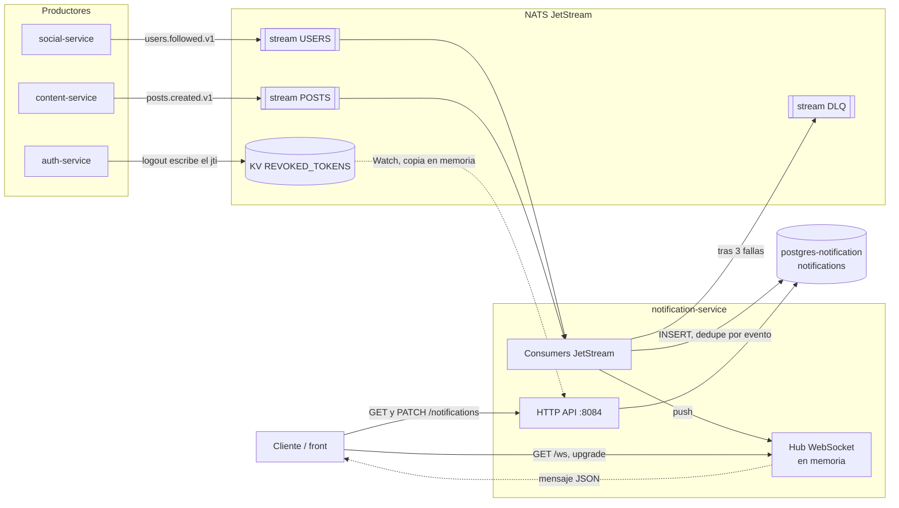
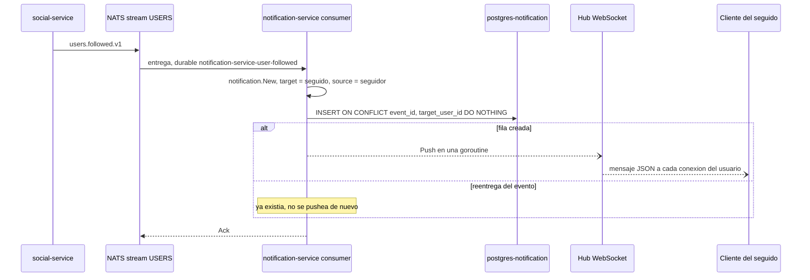
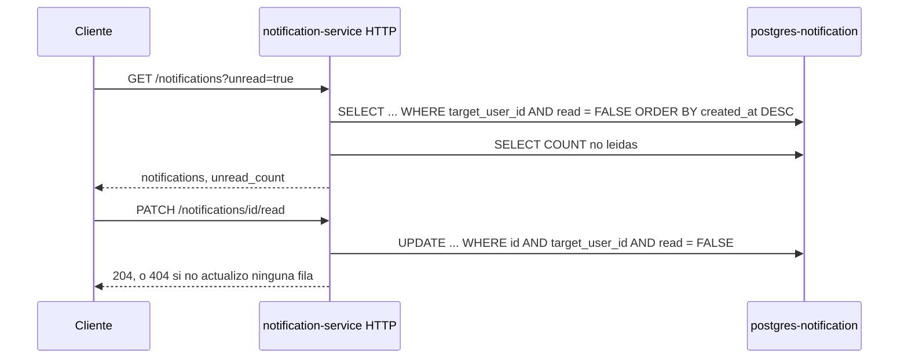

# notification-service

Bounded context de **notificaciones**: genera avisos para un usuario a partir de eventos del
sistema (hoy, que alguien lo empezó a seguir), los guarda, los empuja en tiempo real por
WebSocket a quien esté conectado y los sirve por HTTP para leerlos y marcarlos como leídos.

| | |
|---|---|
| Puerto | `8084` (HTTP y WebSocket) |
| Base de datos | `postgres-notification` → `ig_notification` |
| Código | [`services/notification-service/`](../../services/notification-service/) |
| Migraciones | [`deploy/migrations/notification-service/`](../../deploy/migrations/notification-service/) |
| Eventos que publica | — |
| Eventos que consume | `users.followed.v1`, `posts.created.v1` (este último solo se loguea) |

---

## Intercomunicación



- **notification-service no llama a ningún servicio por HTTP y nadie lo llama a él**, salvo el
  cliente. Todo lo que dispara una notificación llega por eventos.
- **auth-service** no se consulta: el JWT se valida localmente (ver
  [AUTH.md](AUTH.md#validación-en-los-otros-servicios)), también en el upgrade del WebSocket.
- **Postgres es la fuente de verdad.** El push por WebSocket es un extra para quien está
  conectado: si no lo está, ve la notificación la próxima vez que pida `GET /notifications`.

---

## Arquitectura

Hexagonal: el dominio y la aplicación no importan nada de infraestructura.

```
services/notification-service/
├── cmd/server/main.go                          # wiring: DB, NATS, consumers, hub, HTTP
├── configs/config.go                           # config desde env vars
└── internal/
    ├── domain/notification/
    │   ├── notification.go                     # Notification, Type, errores
    │   └── repository.go                       # puerto notification.Repository
    ├── application/
    │   ├── port/input/  notification_usecase.go  # puerto driving: listar, marcar leídas
    │   ├── port/output/ pusher.go              # puerto driven: NotificationPusher
    │   │                event_publisher.go     # puerto driven: EventPublisher (sin uso)
    │   └── usecase/     notification_service.go  # casos de uso + CreateAndPush
    └── infrastructure/
        ├── http/        handler/ router/ middleware/   # adaptador HTTP (chi) + JWTMiddleware
        ├── messaging/nats/consumer.go          # adaptador driving: eventos → CreateAndPush
        ├── persistence/postgres/               # NotificationRepository
        └── ws/hub.go                           # adaptador NotificationPusher (gorilla/websocket)
```

Dependencias de `shared/`:
- `shared/events`: `Envelope`, tópicos y payloads que consume.
- `shared/dlq`: suscripción durable con reintentos, backoff, aviso de "en proceso" y DLQ (ver
  [FEED.md](FEED.md#reintentos-y-dlq), es la misma política).
- `shared/revocation`: `Denylist`, la lista de access tokens revocados por logout.

---

## Modelo de dominio

### `Notification`

| Campo | Regla |
|---|---|
| `ID` | UUID generado en `notification.New`. |
| `TargetUserID` | Quién la recibe. Obligatorio. |
| `SourceUserID` | Quién la generó. Obligatorio y distinto de `TargetUserID` (no hay auto-notificaciones). |
| `Type` | `new_follower`, `new_post`, `post_liked` o `comment_added`. **Hoy solo se genera `new_follower`.** |
| `Payload` | Mapa `string → string` con datos para el cliente. Para `new_follower`: `{"follower_id": "..."}`. |
| `EventID` | ID del evento del bus que la originó. Clave de idempotencia (ver abajo). |
| `Read` / `ReadAt` | Lo único que cambia después de creada. |

### Idempotencia

JetStream entrega at-least-once, así que el mismo evento puede llegar más de una vez. La tabla
tiene un índice único parcial sobre `(event_id, target_user_id)`: un evento genera como mucho
una notificación por destinatario, y una reentrega no duplica ni vuelve a pushear
(`CreateAndPush` solo pushea si el `INSERT` creó la fila). Incluye `target_user_id` porque un
mismo evento puede notificar a varios usuarios (pensado para `posts.created`).

---

## API HTTP

Todas las respuestas de error tienen la forma `{"error": "<mensaje>"}`. Todas las rutas salvo
`/health` y `/ready` exigen `Authorization: Bearer <access_token>`, y operan siempre sobre las
notificaciones **del usuario del token**.

| Método | Ruta | Éxito |
|---|---|---|
| `GET` | `/notifications` | `200` lista + total de no leídas |
| `PATCH` | `/notifications/{id}/read` | `204` |
| `PATCH` | `/notifications/read-all` | `204` |
| `GET` | `/ws` | `101` upgrade a WebSocket |
| `GET` | `/health`, `/ready` | `200` (sin body) |

Los endpoints con Bearer responden `401` con `missing authorization header`, `invalid token`,
`token expired` o `token revoked`. La spec está en
[`api/openapi/specs.yaml`](../../api/openapi/specs.yaml) (tag `Notification`).

### `GET /notifications?limit=20&offset=0&unread=true`

- `limit`: default 20, máximo 100. Un valor no numérico o `≤ 0` usa el default.
- `offset`: default 0. Paginación por offset.
- `unread=true`: solo las no leídas. Cualquier otro valor, todas.
- Orden: más recientes primero.

```json
{
  "notifications": [
    {
      "id": "e2464a0c-0f93-4e48-bf18-dc3e498b5257",
      "type": "new_follower",
      "source_user_id": "f7c3a3eb-6804-4e2b-a998-f3393b7f93fa",
      "payload": { "follower_id": "f7c3a3eb-6804-4e2b-a998-f3393b7f93fa" },
      "read": false,
      "created_at": "2026-10-23T15:44:53Z"
    }
  ],
  "unread_count": 2
}
```

`unread_count` es el total de no leídas del usuario, no de la página. Sale de un segundo query,
así que el número del badge no depende de `limit` ni de `unread`.

| Status | Cuándo |
|---|---|
| `200` | Lista, posiblemente vacía. |
| `401` | Token ausente o inválido. |
| `500` | Error inesperado, **y también** un `offset` negativo (ver [limitaciones](#limitaciones-conocidas)). |

### `PATCH /notifications/{id}/read`

| Status | Cuándo |
|---|---|
| `204` | Marcada como leída. |
| `400` | `id` no es un UUID. |
| `404` | No existe, es de otro usuario, **o ya estaba leída**. |

Una notificación de otro usuario da `404`, no `403`: no revela que el ID existe.

### `PATCH /notifications/read-all`

Marca como leídas todas las no leídas del usuario. Siempre `204`, aunque no hubiera ninguna.

### `GET /ws`

Upgrade a WebSocket autenticado con `JWTWebSocketMiddleware`, que valida el token igual que el
resto (firma, expiración, `kind`, lista de revocados) pero lo acepta de dos formas:

| Cliente | Cómo manda el token |
|---|---|
| Navegador | Como **subprotocolo**: `new WebSocket(url, ["access_token", token])`. El servidor responde eligiendo `access_token` (si no lo hiciera, el navegador cortaría la conexión). |
| Otros (CLI, apps, tests) | Header `Authorization: Bearer <token>`, como en el resto de la API. |

La API `WebSocket` del navegador no permite mandar headers; el subprotocolo es lo único del
request del upgrade que se puede elegir. **No se acepta por query string** (`/ws?token=...`): chi
loguea la URL completa y el token quedaría en los logs.

El upgrader acepta cualquier `Origin`. No es un riesgo mientras la auth no vaya por cookie: otra
página puede abrir un WebSocket contra el servicio, pero sin el token del usuario recibe `401`.
Si algún día se autentica con cookie, hay que restringir los orígenes.

```js
const ws = new WebSocket("ws://localhost:8084/ws", ["access_token", accessToken]);
ws.onmessage = (e) => mostrar(JSON.parse(e.data));
```

| Status | Cuándo |
|---|---|
| `101` | Conexión establecida. |
| `401` | Sin token (`missing access token`), o token inválido, expirado o revocado. |

El token se valida **solo en el upgrade**: una conexión abierta sigue abierta aunque el token
expire o se haga logout (ver [limitaciones](#limitaciones-conocidas)).

- Un usuario puede tener **varias conexiones** (pestañas, dispositivos); cada notificación va a
  todas.
- El servidor manda un mensaje de texto JSON por notificación; el cliente no tiene que mandar
  nada (lo que mande se lee y se descarta, hasta 512 bytes):

  ```json
  {"type":"new_follower","id":"6212fdac-...","payload":{"follower_id":"00a0c5b8-..."},"created_at":"2026-10-23T15:45:09Z"}
  ```

- **Keepalive:** el servidor manda un ping cada 54 s y corta si no recibe pong en 60 s. Los
  navegadores responden los pings solos.
- Cada conexión tiene un buffer de 64 mensajes. Si se llena (cliente que no lee o conexión
  muy lenta), el servidor cierra **esa** conexión; el resto sigue igual. El cliente tiene que
  reconectar y pedir `GET /notifications` para recuperar lo que se perdió.

#### Ciclo de vida de una conexión

Cada conexión tiene dos goroutines: `writePump` (manda notificaciones y pings) y `readPump`
(lee pongs y detecta el corte). El fin de la conexión se señala cerrando un canal `done`, una
sola vez (`sync.Once`); el canal de mensajes `send` no se cierra nunca. Así, que `Push` (cliente
lento) y `readPump` (desconexión) llamen los dos a `remove` para la misma conexión, o que un
`Push` coincida con una desconexión, no rompe nada. `Push` además recorre una copia de la lista
de conexiones tomada bajo lock.

---

## Flujos

### Nuevo seguidor



- **El push no bloquea el ack:** corre en una goroutine aparte, después de guardar. Si el
  usuario no está conectado, no pasa nada; si falla, la notificación igual está en la DB.
- **El orden de los pushes no está garantizado** cuando llegan varias notificaciones juntas
  (una goroutine por cada una). El cliente puede ordenar por `created_at`.
- Un evento con seguidor y seguido iguales falla en `notification.New` y va directo a la DLQ
  (`dlq.Permanent`).

### `posts.created.v1`

Se consume (durable `notification-service-post-created`) pero **solo se loguea**: notificar a
los seguidores del autor requiere conocer el grafo, que este servicio no tiene (ver
[pendiente](#pendiente)).

### Lectura y marcado



---

## Persistencia

| Tabla | Uso |
|---|---|
| `notifications` | Una fila por notificación. `payload` es `JSONB`. `event_id` nullable. |

Índices:

| Índice | Para |
|---|---|
| `(target_user_id, created_at DESC)` | Listado del usuario. |
| `(target_user_id, read) WHERE read = FALSE` | Conteo y listado de no leídas. |
| `UNIQUE (event_id, target_user_id) WHERE event_id IS NOT NULL` | Idempotencia ante reentregas. |

El repositorio usa el pool directamente: ninguna operación necesita transacción.

Migraciones (golang-migrate, las corre el contenedor `migrate-notification` al levantar el
stack):

| Versión | Contenido |
|---|---|
| `0001` | `notifications` e índices de listado |
| `0002` | `event_id` + índice único de idempotencia |

---

## Eventos

notification-service **no publica eventos**. Consume:

| Tópico | Stream | Durable | Qué hace |
|---|---|---|---|
| `users.followed.v1` | `USERS` | `notification-service-user-followed` | Notificación `new_follower` para el seguido. |
| `posts.created.v1` | `POSTS` | `notification-service-post-created` | Solo loguea. |

Reintentos y DLQ: la misma política de `shared/dlq` que feed-service (3 entregas con backoff de
1 s y 5 s, payload inválido directo a la DLQ, aviso de "en proceso" cada 10 s), descripta en
[FEED.md](FEED.md#reintentos-y-dlq).

Al arrancar crea solo el stream `DLQ`. **No crea `USERS` ni `POSTS`:** los crean content-service
y feed-service (ver [limitaciones](#limitaciones-conocidas)).

---

## Configuración

| Variable | Requerida | Default | Descripción |
|---|---|---|---|
| `JWT_SECRET` | Sí | — | Secreto HMAC. Debe coincidir con auth-service. |
| `DB_DSN` | Sí | — | DSN de Postgres. |
| `NATS_URL` | Sí | — | URL de NATS. |
| `PORT` | No | `8084` | Puerto HTTP y WebSocket. |
| `HTTP_READ_TIMEOUT` / `HTTP_WRITE_TIMEOUT` | No | `10s` | Aplican al upgrade; una vez establecido, el WebSocket usa sus propios plazos (ping/pong). |
| `HTTP_IDLE_TIMEOUT` | No | `60s` | |
| `DB_CONNECT_TIMEOUT` / `NATS_CONNECT_TIMEOUT` | No | `5s` | |
| `LOG_LEVEL` | No | `info` | No se lee. |

Si falta alguna variable requerida, el servicio no arranca y lista todas las que faltan juntas.
Una duración con formato inválido cae al default **sin avisar**.

El pool de Postgres usa 10 conexiones máximas y 2 mínimas (fijo en código). La conexión a NATS
reintenta para siempre (`MaxReconnects(-1)`).

Constantes del WebSocket (fijas en `ws/hub.go`):

| Constante | Valor |
|---|---|
| Buffer de salida por conexión | 64 mensajes |
| Ping del servidor | cada 54 s |
| Espera de pong | 60 s |
| Timeout de escritura | 10 s |
| Tamaño máximo de mensaje del cliente | 512 bytes |

---

## Operación

```bash
docker compose up -d notification-service   # desde la raíz (el .env define COMPOSE_FILE)
make logs-notification                      # logs JSON (slog)
make dlq-list                               # mensajes en la DLQ (de todos los servicios)
```

- **Logs:** JSON por stdout. Las conexiones WebSocket loguean `ws: client connected` /
  `ws: client disconnected` con `user_id` y cuántas conexiones tiene. Los requests HTTP no
  loguean nada propio salvo la línea de chi (`middleware.Logger`, texto plano).
- **Probar el WebSocket:** desde la consola del navegador,
  `new WebSocket("ws://localhost:8084/ws", ["access_token", TOKEN])`; desde la terminal,
  `websocat -H "Authorization: Bearer $TOKEN" ws://localhost:8084/ws`.
- **Graceful shutdown:** con `SIGINT`/`SIGTERM` deja de aceptar requests (timeout de 15 s). Las
  conexiones WebSocket no se cierran ordenadamente: se cortan al terminar el proceso y el
  cliente tiene que reconectar.
- **Tests:** con `go test -race`:
  - [`hub_test.go`](../../services/notification-service/internal/infrastructure/ws/hub_test.go):
    un cliente que no lee se desconecta sin panic, pushes concurrentes con conexiones que
    entran y salen, y un push llega a todas las conexiones del usuario.
  - [`jwt_middleware_test.go`](../../services/notification-service/internal/infrastructure/http/middleware/jwt_middleware_test.go):
    token como subprotocolo (y que el servidor lo selecciona), token en header, y `401` sin
    token, con token inválido o por query string.

  No hay tests de los casos de uso, del consumer ni del repositorio.

---

## Pendiente

El servicio está en etapa de desarrollo. Nada de esto es un bug: son piezas que todavía no se
conectaron y restos de código para limpiar.

- **Notificar posts nuevos:** el consumer de `posts.created.v1` tiene un `TODO`. Hace falta
  saber quién sigue al autor; las opciones son una copia local del grafo (como hace
  feed-service) o un evento que ya traiga los destinatarios.
- **Likes y comentarios:** los tipos `post_liked` y `comment_added` existen para un
  interaction-service que todavía no existe.
- **Varias réplicas:** el `Hub` vive en memoria. Con más de una instancia, el consumer durable
  reparte los eventos entre ellas y el push solo llega a las conexiones de la instancia que
  procesó el evento. Hace falta un fan-out entre instancias (ej. un subject NATS core por
  usuario).
- **Retención:** `notifications` crece sin límite.
- **Tests:** faltan los de casos de uso, consumer y repositorio (ver [Operación](#operación)).
- **`/ready`** responde `200` siempre.
- **Restos para limpiar:** el puerto `EventPublisher`, el error `ErrNotOwner` y el método de
  dominio `Notification.MarkRead` no se usan (el repositorio marca con SQL); `LOG_LEVEL` no se
  lee.

---

## Limitaciones conocidas

Ordenadas por impacto. Las dos primeras están verificadas.

1. **Un `offset` negativo da `500`.** Se pasa tal cual a SQL y Postgres lo rechaza
   (`OFFSET must not be negative`). content-service lo clampea a 0; este servicio no.

2. **Marcar como leída no es idempotente.** Una notificación ya leída da `404` en
   `PATCH /notifications/{id}/read`, igual que una que no existe: un cliente que reintenta
   (o dos pestañas) recibe un error engañoso.

3. **Arranque en un NATS vacío.** notification-service no crea los streams `USERS` ni `POSTS`.
   Si arranca antes que content-service o feed-service sobre un NATS nuevo, la suscripción
   falla, el proceso sale y Docker lo reinicia hasta que alguno de ellos los cree. El compose
   no declara esa dependencia.

4. **Una notificación por cada follow.** Seguir, dejar de seguir y volver a seguir genera una
   notificación nueva cada vez (cada follow es un evento distinto), y el unfollow no borra la
   anterior.

5. **Sin CORS.** A diferencia del resto de los servicios, no tiene middleware de CORS: un
   preflight desde `http://localhost:5173` da `405`. Funciona solo detrás del proxy del front
   (mismo origen).

6. **El WebSocket no se entera de un logout.** El token se valida solo en el upgrade: si
   expira o se revoca después, la conexión sigue abierta y recibiendo notificaciones hasta que
   el cliente la cierre.
