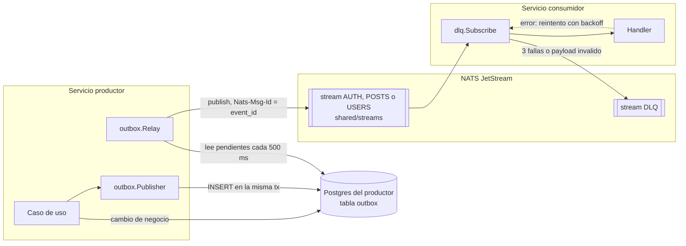
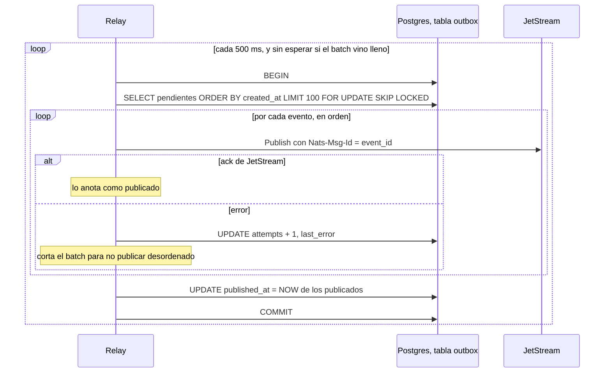
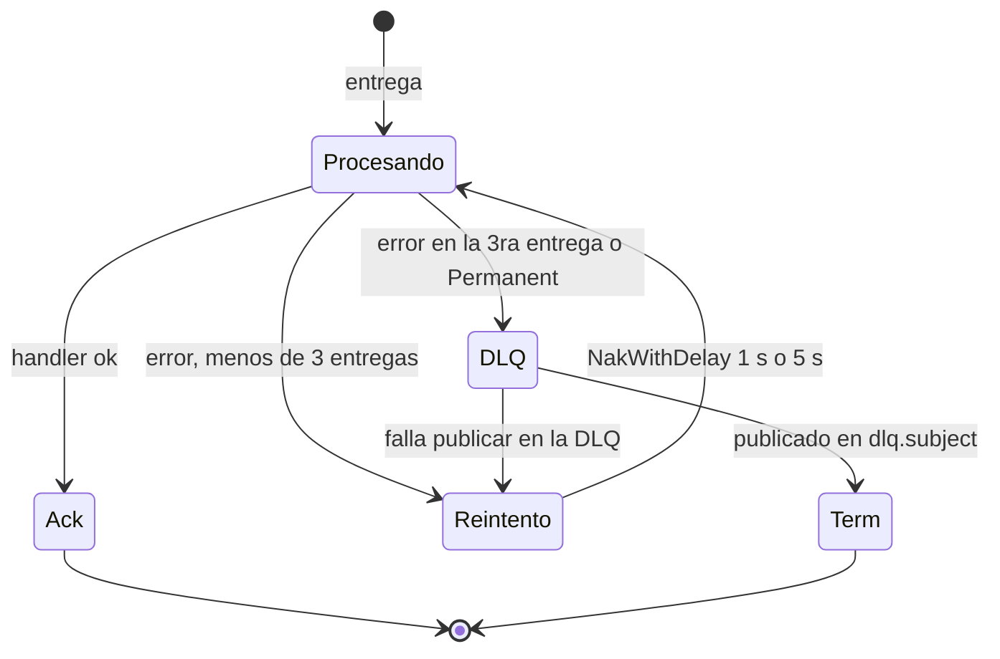

# shared

Módulo Go con lo que comparten los servicios: el contrato de los eventos, cómo se publican
(transactional outbox), dónde viven (streams de JetStream), cómo se consumen (reintentos y dead
letter queue) y la lista de tokens revocados por logout. No tiene lógica de negocio de ningún
dominio: cada servicio define su propio dominio y sus propios puertos.

| | |
|---|---|
| Módulo | `github.com/juantevez/my-ig/shared` |
| Código | [`shared/`](../../shared/) |
| Cómo lo usan los servicios | `replace github.com/juantevez/my-ig/shared => ../../shared` en cada `go.mod`; los Dockerfiles copian `shared/` junto al servicio |

| Paquete | Para qué | auth | content | feed | social | notification |
|---|---|:-:|:-:|:-:|:-:|:-:|
| [`events`](#events) | Envelope, tópicos y payloads | ✓ | ✓ | ✓ | ✓ | ✓ |
| [`outbox`](#outbox) | Transacciones y publicación atómica de eventos | ✓ | ✓ | tx | ✓ | tx |
| [`streams`](#streams) | Declaración única de los streams de eventos | ✓ | ✓ | ✓ | ✓ | ✓ |
| [`dlq`](#dlq) | Consumo con reintentos y dead letter queue | | | ✓ | ✓ | ✓ |
| [`revocation`](#revocation) | Lista de access tokens revocados (logout) | ✓ | ✓ | ✓ | ✓ | ✓ |
| [`cmd/dlq`](#cli-de-la-dlq) | CLI para inspeccionar y reprocesar la DLQ | — | — | — | — | — |

"tx" = solo usa `TxManager`/`Conn` para sus transacciones; no publica eventos.

---

## Recorrido de un evento

1. El caso de uso guarda el cambio y el evento **en la misma transacción** (`Publisher` escribe en
   la tabla `outbox`): o quedan los dos o ninguno.
2. El `Relay` de ese servicio publica los pendientes a JetStream, en orden.
3. Cada consumidor recibe el evento por un consumer durable (`dlq.Subscribe`) y lo procesa con
   reintentos; si no puede, el evento va a la DLQ en vez de perderse.

---

## events

Contrato de los eventos del bus: [`envelope.go`](../../shared/events/envelope.go),
[`topics.go`](../../shared/events/topics.go) y un archivo de payloads por dominio (`auth.go`,
`posts.go`, `social.go`).

### `Envelope`

Todo evento viaja envuelto. `events.Wrap` completa `event_id`, `version` y `timestamp`.

| Campo | Contenido |
|---|---|
| `event_id` | UUID nuevo por evento. Es el `Nats-Msg-Id` (dedupe en JetStream) y la clave de idempotencia de los consumidores. |
| `event_type` | El tópico, ej. `users.followed.v1`. |
| `version` | Siempre `1.0.0`. |
| `timestamp` | UTC, cuando se armó el evento. |
| `source_service` | Quién lo publicó. |
| `idempotency_key` | Clave de negocio de la operación (ej. `idemp:social:follow:<a>:<b>`). Hoy ningún consumidor la lee. |
| `trace_id` | El request ID de chi del request que lo originó. |
| `payload` | El payload del tópico (ver abajo). |
| `metadata` | Región, tipo de cliente, prioridad. Hoy nadie la completa. |

`Payload` es `any`: al deserializar llega como `map[string]any`. Los consumidores lo vuelven a
serializar y lo decodifican al tipo concreto (`decodePayload` en cada consumer). Un payload que
no se puede decodificar es un error permanente y va directo a la DLQ.

### Tópicos

Convención `{dominio}.{entidad}.{acción}.{versión}`. Si cambia la semántica de un payload se crea
un tópico nuevo (`.v2`); el existente no se modifica.

| Tópico | Stream | Productor | Consumidores |
|---|---|---|---|
| `auth.user.registered.v1` | `AUTH` | auth-service | social-service |
| `auth.user.logged_in.v1` | `AUTH` | auth-service | — |
| `posts.created.v1` | `POSTS` | content-service | feed-service, notification-service |
| `posts.deleted.v1` | `POSTS` | content-service | feed-service |
| `users.followed.v1` | `USERS` | social-service | feed-service, notification-service |
| `users.unfollowed.v1` | `USERS` | social-service | feed-service, notification-service |
| `interactions.liked.v1` | — | (interaction-service, no existe) | — |
| `interactions.comment_added.v1` | — | (interaction-service, no existe) | — |

Los payloads y qué hace cada consumidor están en el doc de cada servicio:
[AUTH](AUTH.md#eventos), [CONTENT](CONTENT.md#eventos), [SOCIAL](SOCIAL.md#eventos),
[FEED](FEED.md#eventos), [NOTIFICATION](NOTIFICATION.md#eventos). Los comentarios
`Producer | Consumers` de `topics.go` son de la etapa de diseño y no coinciden con esta tabla.

`events.DLQ(topic)` arma el subject de dead letter: `dlq.<tópico>`.

---

## outbox

Transactional outbox sobre Postgres + JetStream: [`tx.go`](../../shared/outbox/tx.go),
[`publisher.go`](../../shared/outbox/publisher.go), [`relay.go`](../../shared/outbox/relay.go).

| Pieza | Qué hace |
|---|---|
| `TxManager.WithinTx(ctx, fn)` | Abre una transacción y la pasa por el `ctx`. Commit si `fn` no falla, rollback si falla. Las llamadas anidadas reusan la transacción. |
| `Conn(ctx, pool)` | La transacción del `ctx` si hay una, el pool si no. Los repositorios la usan para participar de `WithinTx` sin cambiar sus firmas. |
| `Publisher.Publish(ctx, topic, payload)` | Inserta el evento en la tabla `outbox` **dentro de la transacción del `ctx`**. Sin transacción retorna `ErrNoTx`: publicar fuera de la tx del negocio rompería la atomicidad. |
| `Relay.Run(ctx)` | Goroutine que publica los pendientes a JetStream hasta que se cancela el `ctx`. |

Cada servicio que publica tiene su tabla `outbox` (misma migración en auth, content y social):

| Columna | |
|---|---|
| `id` | `event_id` del envelope; se usa como `Nats-Msg-Id`. |
| `topic`, `payload` | Subject y envelope serializado (`JSONB`). |
| `created_at` | `clock_timestamp()`: orden de publicación. |
| `published_at` | `NULL` mientras está pendiente. |
| `attempts`, `last_error` | Intentos fallidos y el último error. |

### Relay

Garantías:

- **At-least-once:** un evento se marca publicado recién con el ack de JetStream. Si el proceso
  cae entre el publish y el `UPDATE`, se vuelve a publicar; JetStream descarta el duplicado si
  llega dentro de su ventana de dedupe (2 minutos por defecto, por `Nats-Msg-Id`). Fuera de esa
  ventana llega duplicado: los consumidores tienen que ser idempotentes.
- **Orden:** se publica por `created_at` y el batch se corta en el primer error, así un unfollow
  nunca sale antes que su follow.
- **Varias réplicas:** `FOR UPDATE SKIP LOCKED` evita que dos relays tomen las mismas filas.
- **Limpieza:** cada hora borra los eventos publicados hace más de 7 días.

El orden y la latencia tienen un costo: un evento que falla siempre frena a todos los que vienen
detrás (ver [limitaciones](#limitaciones-conocidas)). Un evento tarda hasta 500 ms en salir.

---

## streams

[`streams.go`](../../shared/streams/streams.go) declara en un solo lugar los streams de eventos de
dominio:

| Stream | Subjects | Productor |
|---|---|---|
| `AUTH` | `auth.>` | auth-service |
| `POSTS` | `posts.>` | content-service |
| `USERS` | `users.>` | social-service |

Configuración canónica: almacenamiento en disco y retención de 7 días (`streams.MaxAge`). Un
consumidor caído más que eso pierde eventos.

**Todos los servicios llaman a `streams.Ensure` al arrancar.** Crea los streams que falten, así
cualquier servicio alcanza para dejar el bus listo sobre un NATS vacío, sin importar el orden de
arranque. Si un stream ya existe con otra configuración, lo actualiza a la canónica; si NATS no
lo permite (ej. cambiar el tipo de storage), lo deja como está y lo loguea
(`streams: stream config differs and could not be updated`) sin frenar el arranque.

Antes cada servicio declaraba los suyos: content-service y feed-service declaraban los tres,
notification-service los dos que consume, y **auth-service y social-service, que son los que
publican en `AUTH` y `USERS`, no declaraban ninguno**. Sobre un NATS vacío, sus relays no podían
publicar (`nats: no response from stream`) hasta que arrancara otro servicio. Además, el target
`make nats-streams` intentaba crearlos con un `PUT` al puerto de monitoreo de NATS, que no tiene
esa API (respondía `404`, oculto por `|| true`); se eliminó.

Fuera de este paquete quedan el stream `DLQ` (lo declara `shared/dlq`) y el bucket KV
`REVOKED_TOKENS` (lo declara `shared/revocation`).

---

## dlq

Consumo de JetStream con reintentos y dead letter queue: [`dlq.go`](../../shared/dlq/dlq.go).
`dlq.Subscribe(js, subject, durable, handler)` crea (o reutiliza) un consumer durable y despacha
cada mensaje al handler, que solo tiene que retornar `nil` o un error. La política la aplica este
paquete, no JetStream:

| El handler retorna | Acción |
|---|---|
| `nil` | `Ack`. |
| Un error | `NakWithDelay`: reintento a 1 s tras la 1ª entrega, a 5 s tras la 2ª. A la 3ª falla (`MaxAttempts`), a la DLQ. |
| Un error envuelto con `dlq.Permanent` | Directo a la DLQ, sin reintentos. Para lo que reintentar no arregla (payload que no se decodifica). |

- **Sin pérdidas silenciosas:** el consumer se crea con `MaxDeliver` ilimitado; los intentos los
  cuenta el paquete. Recién con el ack de la DLQ se hace `Term` del original; si publicar en la
  DLQ falla, el mensaje se sigue reentregando. `Subscribe` migra a `MaxDeliver` ilimitado los
  durables existentes que se hayan creado con un límite.
- **Handlers lentos:** mientras el handler corre, se le avisa a JetStream cada 10 s que el
  mensaje sigue en proceso (`InProgress`), lo que reinicia el `AckWait` de 30 s. Un handler que
  tarda más de 30 s no recibe una reentrega del mismo mensaje en el medio.
- **Consumers nuevos:** se crean con `DeliverNew`: un durable nuevo procesa solo los eventos
  publicados desde que existe, no el histórico del stream.

En la DLQ, el mensaje queda en el subject `dlq.<subject original>` (stream `DLQ`, retención 30
días) con el payload original y headers de contexto:

| Header | |
|---|---|
| `Dlq-Original-Subject` | Subject donde se publicó. |
| `Dlq-Consumer` | Durable que falló. |
| `Dlq-Error` | El último error. |
| `Dlq-Deliveries` | Cuántas veces se entregó. |
| `Dlq-Stream-Seq` | Secuencia en el stream original. |
| `Dlq-Failed-At` | Cuándo se mandó a la DLQ. |

El `Nats-Msg-Id` original se saca: si no, la DLQ deduplicaría el mismo evento fallado por dos
consumers distintos.

### CLI de la DLQ

[`cmd/dlq`](../../shared/cmd/dlq/main.go), con targets en el `Makefile`:

| Comando | `make` | Qué hace |
|---|---|---|
| `dlq list` | `make dlq-list` | Lista los mensajes: subject, consumer, entregas, fecha y error. |
| `dlq show <seq>` | `make dlq-show SEQ=n` | Headers y payload de un mensaje. |
| `dlq replay <seq>` | `make dlq-replay SEQ=n` | Lo republica a su subject original y lo borra de la DLQ. |
| `dlq replay all [-consumer X]` | `make dlq-replay-all [CONSUMER=x]` | Ídem con todos, o solo los de un consumer. |
| `dlq discard <seq>` | `make dlq-discard SEQ=n` | Lo borra sin reprocesar. |

**Ojo con el replay:** republica al subject original, así que el evento le llega a **todos** los
consumidores de ese subject, no solo al que falló. Funciona porque todos son idempotentes por
`event_id`.

---

## revocation

Lista de access tokens revocados por logout: [`denylist.go`](../../shared/revocation/denylist.go).
Los access tokens son stateless y cada servicio los valida por su cuenta, así que la revocación
tiene que llegar a todos.

- **Almacenamiento:** bucket KV de JetStream `REVOKED_TOKENS` (clave `jti`, valor `exp` del
  token), con TTL de 24 h, más que cualquier access token.
- **Escritura:** `Revoke(jti, exp)`, solo auth-service en el logout.
- **Lectura:** cada servicio mantiene una copia en memoria que se actualiza por `Watch`, así
  `IsRevoked(jti)` no hace ningún viaje por red. `New` carga todas las revocaciones vigentes
  antes de retornar: un servicio recién arrancado no acepta tokens ya revocados. Cada minuto se
  sacan de memoria los tokens ya vencidos.
- **Avisos:** `OnRevoke(fn)` llama a `fn` con cada revocación nueva (una vez por `jti`). Lo usa
  notification-service para cerrar en el momento los WebSockets abiertos con ese token, que
  `IsRevoked` no alcanza porque solo se consulta por request.

Detalle del logout y de la validación en [AUTH.md](AUTH.md#revocación-logout).

---

## Tests

Solo [`denylist_test.go`](../../shared/revocation/denylist_test.go): `OnRevoke` avisa una vez por
`jti` nuevo y no avisa por tokens ya vencidos. El resto (relay, publisher, dlq, streams) se probó
contra NATS y Postgres reales durante el desarrollo, pero no tiene tests automáticos: necesitan
un NATS (o un servidor embebido) y un Postgres para correr.

---

## Pendiente

El módulo está en etapa de desarrollo. Nada de esto es un bug: son piezas que todavía no se
conectaron y restos para limpiar.

- **Tópicos de interacciones:** `interactions.liked.v1` y `interactions.comment_added.v1` están
  definidos para un interaction-service que no existe, y no tienen stream: cuando exista, hay que
  agregar el stream a `shared/streams` (si no, su relay no puede publicar).
- **Campos del `Envelope` sin uso:** `idempotency_key` (los consumidores deduplican por
  `event_id`) y `metadata`.
- **Comentarios de `topics.go`:** listan consumidores de la etapa de diseño (analytics, "rebuild
  parcial", "ZREM") que no coinciden con lo implementado.
- **Middleware JWT:** cada servicio tiene su propia copia de `JWTMiddleware` (casi idéntica).
  Podría vivir en `shared/`.
- **Tests:** de outbox, dlq y streams, con NATS y Postgres de prueba.

---

## Limitaciones conocidas

1. **Un evento que no se puede publicar frena a todos los siguientes de ese servicio.** Para
   preservar el orden, el relay corta el batch en el primer error y lo reintenta cada 500 ms para
   siempre. Si un evento falla de forma permanente (ej. un subject sin stream, como los de
   `interactions.*`, o un mensaje más grande que el máximo de NATS), ninguno de los que vienen
   detrás sale. Se ve en `outbox.attempts` / `last_error` y en el log
   `outbox relay: batch failed`.

2. **La dedupe de JetStream dura 2 minutos.** Si el relay publica un evento y el proceso cae antes
   de marcarlo, al reiniciar lo vuelve a publicar; pasados 2 minutos, JetStream ya no lo reconoce
   como duplicado. Los consumidores actuales son idempotentes, así que no hay efecto, pero
   cualquier consumidor nuevo tiene que serlo.
