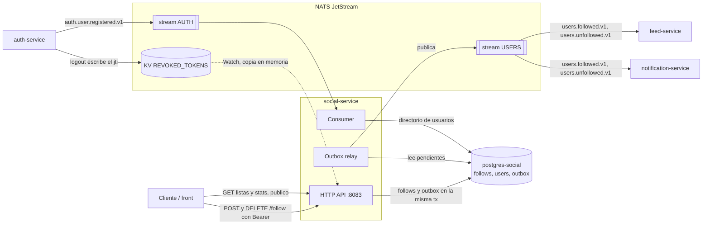
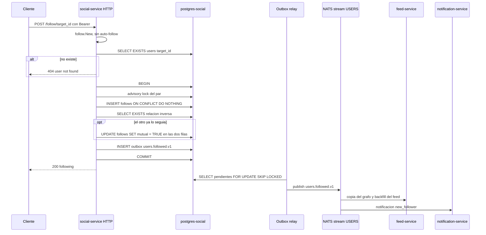

# social-service

Bounded context del **grafo social**: quién sigue a quién. Registra follows y unfollows, marca
las relaciones mutuas, expone las listas de seguidores/seguidos y sus contadores, y avisa de cada
cambio con eventos. Es la fuente de verdad del grafo; feed-service y notification-service
mantienen copias derivadas de esos eventos.

| | |
|---|---|
| Puerto | `8083` |
| Base de datos | `postgres-social` → `ig_social` |
| Código | [`services/social-service/`](../../services/social-service/) |
| Migraciones | [`deploy/migrations/social-service/`](../../deploy/migrations/social-service/) |
| Eventos que publica | `users.followed.v1`, `users.unfollowed.v1` |
| Eventos que consume | `auth.user.registered.v1` (directorio de usuarios) |

---

## Intercomunicación



- **social-service no llama a ningún servicio por HTTP y nadie lo llama a él**, salvo el
  cliente. Los demás se enteran de los cambios por eventos.
- **Directorio de usuarios propio:** para rechazar follows a usuarios inexistentes no consulta a
  auth-service: mantiene la tabla `users` a partir de `auth.user.registered.v1` (ver
  [abajo](#directorio-de-usuarios)).
- **auth-service** no se consulta: el JWT se valida localmente (ver
  [AUTH.md](AUTH.md#validación-en-los-otros-servicios)).

---

## Arquitectura

Hexagonal: el dominio y la aplicación no importan nada de infraestructura (salvo
`chimiddleware.GetReqID` en el caso de uso, para el `trace_id`).

```
services/social-service/
├── cmd/server/main.go                          # wiring: DB, NATS, streams, outbox relay, HTTP
├── configs/config.go                           # config desde env vars
└── internal/
    ├── domain/
    │   ├── follow/  follow.go                  # agregado Follow, Stats, errores
    │   │            events.go                  # builders de Envelope (followed, unfollowed)
    │   │            repository.go              # puerto follow.Repository
    │   └── user/    user.go                    # puerto user.Repository (directorio de usuarios)
    ├── application/
    │   ├── port/input/  follow_usecase.go      # puerto driving: Follow, Unfollow, listas, stats
    │   ├── port/output/ event_publisher.go     # puerto driven: EventPublisher
    │   │                tx_manager.go          # puerto driven: TxManager
    │   └── usecase/     follow_service.go      # follow, unfollow, listas, stats
    │                    user_service.go        # RegisterUser (directorio)
    └── infrastructure/
        ├── http/        handler/ router/ middleware/   # adaptador HTTP (chi) + JWTMiddleware
        ├── messaging/natsconsumer/consumer.go  # auth.user.registered.v1 → RegisterUser
        └── persistence/postgres/               # FollowRepository, UserRepository
```

Dependencias de `shared/` (ver [SHARED.md](SHARED.md)):
- `shared/events`: `Envelope`, tópicos y payloads (`UserFollowedPayload`, `UserUnfollowedPayload`).
- `shared/outbox`: `TxManager`, `Publisher` (escribe en la tabla `outbox`) y `Relay` (publica a JetStream).
- `shared/streams`: declara y crea el stream `USERS` donde publica.
- `shared/dlq`: consume `auth.user.registered.v1` con reintentos y DLQ.
- `shared/revocation`: `Denylist`, la lista de access tokens revocados por logout.

---

## Modelo de dominio

### `Follow` (agregado raíz)

| Campo | Regla |
|---|---|
| `ID` | UUID generado en `follow.New`. |
| `FollowerID` | Quien sigue. Es siempre el `sub` del token. |
| `FollowingID` | A quien sigue. Tiene que existir en el directorio de usuarios (`ErrUserNotFound`) y ser distinto de `FollowerID` (`ErrSelfFollow`; la DB también lo impide con un `CHECK`). |
| `Mutual` | `true` si los dos se siguen. Se mantiene en **las dos filas** del par: al completarse la relación mutua y al romperse. |
| `CreatedAt` | UTC. Es el `followed_at` del evento. |

Una relación es única por par `(follower_id, following_id)`. Dejar de seguir **borra** la fila:
el historial de la relación no se guarda acá, solo en los eventos.

Errores de dominio:

| Error | Se traduce a |
|---|---|
| `ErrSelfFollow` | `400` |
| `ErrUserNotFound` | `404` |
| `ErrAlreadyFollowing` | `409` |
| `ErrNotFollowing` | `404` |

### Directorio de usuarios

Tabla `users` (`id`, `username`, `registered_at`), alimentada por `auth.user.registered.v1`
(durable `social-service-user-registered`, con reintentos y DLQ de `shared/dlq`). El email del
evento no se copia. Un usuario llega al directorio en menos de un segundo después de
registrarse (lo que tarda el relay de auth-service en publicar).

Solo se valida el **seguido**: el seguidor es el `sub` de un token que emitió auth-service.

Los usuarios registrados antes de que existiera el directorio se cargan una vez con
[`deploy/scripts/backfill-social-users.sh`](../../deploy/scripts/backfill-social-users.sh), que
copia `id`, `username` y `created_at` de `ig_auth` a `ig_social` (ver [Operación](#operación)).
Hace falta porque el stream `AUTH` retiene solo 7 días y el consumer durable arranca con
`DeliverNew`.

### `Stats`

`follower_count` (cuántos lo siguen) y `following_count` (a cuántos sigue). Se calculan con un
`COUNT(*)` en cada pedido; no hay contadores materializados.

---

## API HTTP

Todas las respuestas de error tienen la forma `{"error": "<mensaje>"}`.

| Método | Ruta | Auth | Éxito |
|---|---|---|---|
| `POST` | `/follow/{target_id}` | Bearer (access) | `200 {"status": "following"}` |
| `DELETE` | `/follow/{target_id}` | Bearer (access) | `204` |
| `GET` | `/users/{user_id}/followers` | — | `200` lista |
| `GET` | `/users/{user_id}/following` | — | `200` lista |
| `GET` | `/users/{user_id}/stats` | — | `200` contadores |
| `GET` | `/health`, `/ready` | — | `200` (sin body) |

Los endpoints con Bearer responden `401` con `missing authorization header`, `invalid token`,
`token expired` o `token revoked`. Las listas y los contadores son **públicos**: cualquiera puede
ver a quién sigue cualquier usuario.

La especificación completa está en [`api/openapi/specs.yaml`](../../api/openapi/specs.yaml) (tag
`Social`).

### `POST /follow/{target_id}`

El usuario del token empieza a seguir a `target_id`. Sin body.

| Status | Cuándo |
|---|---|
| `200` | Relación creada. Se encola `users.followed.v1` en la misma transacción. |
| `400` | `target_id` no es un UUID, o es el propio usuario (`cannot follow yourself`). |
| `401` | Token ausente, inválido, expirado o revocado. |
| `404` | `user not found`: el usuario no existe en el directorio. |
| `409` | Ya lo seguía. |
| `500` | Error inesperado. |

### `DELETE /follow/{target_id}`

| Status | Cuándo |
|---|---|
| `204` | Relación borrada. Se encola `users.unfollowed.v1` en la misma transacción. |
| `400` | `target_id` no es un UUID. |
| `401` | Token ausente o inválido. |
| `404` | No lo seguía. |
| `500` | Error inesperado. |

### `GET /users/{user_id}/followers` y `/following`

```json
[
  { "follower_id": "e9663e43-...", "following_id": "98a6570f-...", "mutual": false }
]
```

- `followers`: relaciones donde `user_id` es el seguido. `following`: donde es el seguidor.
- Orden: más recientes primero.
- `limit`: default 20, máximo 100. Un valor no numérico o `≤ 0` usa el default.
- `offset`: default 0. Paginación por offset; la respuesta no trae total ni indicador de más
  páginas.
- Un usuario sin relaciones (o inexistente) devuelve `200 []`.

| Status | Cuándo |
|---|---|
| `200` | Lista, posiblemente vacía. |
| `400` | `user_id` no es un UUID. |
| `500` | Error inesperado, **y también** un `offset` negativo (ver [limitaciones](#limitaciones-conocidas)). |

### `GET /users/{user_id}/stats`

```json
{ "user_id": "e9663e43-...", "follower_count": 1, "following_count": 2 }
```

---

## Flujos

### Follow



- **Relación y evento son atómicos** (transactional outbox): o quedan los dos o ninguno. Si NATS
  está caído, el follow igual responde `200` y el evento sale cuando vuelve.
- `ON CONFLICT DO NOTHING` sin filas afectadas es `ErrAlreadyFollowing` (`409`).
- **Lock del par:** follow y unfollow toman un advisory lock sobre el par de usuarios, sin
  importar la dirección. Sin él, si A sigue a B y B sigue a A al mismo tiempo, cada transacción
  busca la relación inversa antes de que la otra haga commit, ninguna la ve y las dos filas
  quedan con `mutual = false`. Probado con 5 pares de follows cruzados simultáneos: todos
  quedaron mutuos.

### Unfollow

`DELETE /follow/{target_id}`, en una transacción con el par lockeado: borra la fila, pone
`mutual = FALSE` en la relación inversa (si existía) y encola `users.unfollowed.v1`. Del lado de los consumidores,
feed-service saca los posts del autor del feed del seguidor y notification-service borra la
notificación "X te siguió".

Follow y unfollow llegan a los consumidores por suscripciones separadas, así que pueden
procesarse desordenados. Los dos consumidores lo resuelven con last-write-wins sobre el
timestamp del evento (`followed_at` / `unfollowed_at`): ver [FEED.md](FEED.md#follow-y-unfollow)
y [NOTIFICATION.md](NOTIFICATION.md#una-notificación-de-seguidor-por-persona).

---

## Persistencia

| Tabla | Uso |
|---|---|
| `follows` | Una fila por relación activa. `UNIQUE (follower_id, following_id)`, `CHECK (follower_id != following_id)`. |
| `users` | Directorio de usuarios (`id`, `username`, `registered_at`), alimentado por eventos. |
| `outbox` | Eventos pendientes de publicar. |

Índices de `follows`: `(following_id, created_at DESC)` para seguidores, `(follower_id,
created_at DESC)` para seguidos, y `(follower_id, following_id)` para el chequeo de mutualidad
(redundante con el índice del `UNIQUE`).

El repositorio usa `outbox.Conn(ctx, pool)`: si hay una transacción en el `ctx` la usa, si no, el
pool.

Migraciones (golang-migrate, las corre el contenedor `migrate-social` al levantar el stack):

| Versión | Contenido |
|---|---|
| `0001` | `follows` e índices |
| `0002` | `outbox` + índice parcial de pendientes |
| `0003` | Recalcula `mutual` en las relaciones existentes (corrige las marcadas de un solo lado) |
| `0004` | `users` (directorio de usuarios) |

---

## Eventos

Se publican con **transactional outbox** (`shared/outbox`, ver [SHARED.md](SHARED.md#outbox)), en
el stream `USERS`. Al arrancar, el servicio crea (si no existen) los streams de eventos de dominio
con `streams.Ensure`; antes no lo hacía, y sobre un NATS vacío el relay no podía publicar hasta
que otro servicio creara `USERS`.

| Tópico | Cuándo | Payload | `idempotency_key` |
|---|---|---|---|
| `users.followed.v1` | Follow | `follower_id`, `following_id`, `mutual`, `followed_at` | `idemp:social:follow:<follower>:<following>` |
| `users.unfollowed.v1` | Unfollow | `follower_id`, `following_id`, `unfollowed_at` | `idemp:social:unfollow:<follower>:<following>` |

El `idempotency_key` se repite si alguien sigue, deja de seguir y vuelve a seguir: los
consumidores deduplican por `event_id`, no por esa clave. `mutual` es `true` solo en el follow que
completa la relación mutua; ningún consumidor lo usa hoy.

Consumidores:

| Servicio | Qué hace |
|---|---|
| feed-service | Mantiene su copia del grafo (`followers`), carga los últimos posts del autor al seguir y los saca al dejar de seguir. |
| notification-service | Crea la notificación `new_follower` al seguir y la borra al dejar de seguir. |

Consume `auth.user.registered.v1` para el [directorio de usuarios](#directorio-de-usuarios).

---

## Configuración

| Variable | Requerida | Default | Descripción |
|---|---|---|---|
| `JWT_SECRET` | Sí | — | Secreto HMAC. Debe coincidir con auth-service. |
| `DB_DSN` | Sí | — | DSN de Postgres. |
| `NATS_URL` | Sí | — | URL de NATS. |
| `PORT` | No | `8083` | Puerto HTTP. |
| `HTTP_READ_TIMEOUT` / `HTTP_WRITE_TIMEOUT` | No | `10s` | |
| `HTTP_IDLE_TIMEOUT` | No | `60s` | |
| `DB_CONNECT_TIMEOUT` / `NATS_CONNECT_TIMEOUT` | No | `5s` | |

Si falta alguna variable requerida, el servicio no arranca y lista todas las que faltan juntas.
Una duración con formato inválido cae al default **sin avisar**. El compose le pasa `LOG_LEVEL`,
pero el servicio no la lee.

El pool de Postgres usa 10 conexiones máximas y 2 mínimas (fijo en código). La conexión a NATS
reintenta para siempre (`MaxReconnects(-1)`), porque el relay depende de ella.

---

## Operación

```bash
docker compose up -d social-service   # desde la raíz (el .env define COMPOSE_FILE)
make logs-social                      # logs JSON (slog)
```

- **Logs:** JSON por stdout con `request_id`, `follower_id` y `target_id`. Además, chi loguea
  cada request en texto plano (`middleware.Logger`).
- **Backfill del directorio:** al aplicar la migración `0004` en un entorno con usuarios ya
  registrados, correr una vez `deploy/scripts/backfill-social-users.sh` (usa los contenedores del
  compose). Es idempotente: imprime cuántos agregó y los que ya estaban se saltean.
- **Graceful shutdown:** con `SIGINT`/`SIGTERM` deja de aceptar requests (timeout de 15 s) y
  después detiene el relay. Los eventos pendientes quedan en `outbox` y se publican al reiniciar.
- **Tests:** [`follow_service_test.go`](../../services/social-service/internal/application/usecase/follow_service_test.go)
  con fakes de los puertos: follow mutuo marca las dos filas y el unfollow desmarca el otro lado,
  follow y unfollow toman el lock del par, follow a un usuario desconocido y auto-follow. No hay
  tests del handler, del consumer ni de los repositorios.

---

## Pendiente

El servicio está en etapa de desarrollo. Nada de esto es un bug: son piezas que todavía no se
conectaron y restos de código para limpiar.

- **Nombres de usuario:** el directorio ya guarda el `username`, pero la API todavía devuelve
  solo UUIDs: el front muestra los primeros 8 caracteres del ID en vez del nombre.
- **Paginación de las listas:** `FollowListResult.Total` existe y nunca se completa; la respuesta
  no dice si hay más páginas.
- **Privacidad del grafo:** las listas y los contadores son públicos. No hay cuentas privadas.
- **Tests:** faltan los del handler, el consumer y los repositorios.
- **`/ready`** responde `200` siempre.
- **Restos para limpiar:** `TraceID` de los comandos se completa y no se lee (el caso de uso toma
  el request ID de chi); `ErrFollowNotFound` no se usa; el índice `(follower_id, following_id)`
  es redundante con el del `UNIQUE`; `X-User-ID` sigue en los headers
  permitidos de CORS; `configs/config.go` no pasa `gofmt`.

---

## Limitaciones conocidas

Ordenadas por impacto.

1. **Un `offset` negativo da `500`.** Se pasa tal cual a SQL y Postgres lo rechaza (verificado).
   content-service y notification-service lo llevan a 0; este servicio no.

2. **Un usuario recién registrado tarda en poder ser seguido.** Hasta que el evento de registro
   llega al directorio (menos de un segundo: el relay de auth-service publica cada 500 ms), un
   follow a ese usuario da `404`.

3. **CORS fijo a `http://localhost:5173`.** El front usa el proxy de Vite/nginx (mismo origen),
   así que hoy no molesta.
